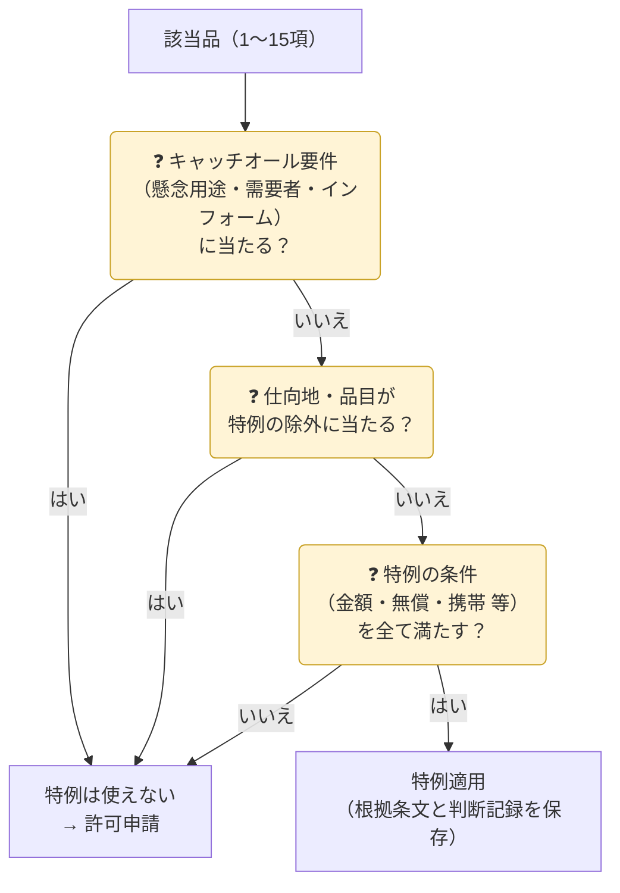

{}
特例は「**非該当になる**」のではなく「**該当品だが許可が不要になる**」だけです。該非判定・取引審査・記録保存は通常どおり必要です。キャッチオールの要件に当たる場合（懸念用途・インフォーム等）は、特例を使えないことが多いです。
{}

## 特例の早見表

| 特例 | 根拠 | 対象 | 主な条件 | 使えない例 |
|---|---|---|---|---|
| **少額特例** | 輸出令 第4条第1項第5号 | 5〜13項・15項の貨物 | 総価額 **100万円以下**（別表第3の3の品目は **5万円以下**） | 1〜4項・14項の貨物／別表第4（イラン・イラク・北朝鮮）向け／キャッチオールの要件に当たる取引 |
| **無償特例** | 輸出令 第4条第1項第2号ホ・ヘ、無償告示 | 告示に定める類型の貨物（**金額基準なし**） | 修理品の再輸出、展示会出品物の返送、ATAカルネ、一時的な出国者が本人用に携帯する一部の品目 など（→ [無償特例の要件](#無償特例無償告示)） | 売買・有償貸与など貨物自体に対価がある輸出／告示の類型に当たらない物（無償サンプル等） |
| **出国者の携帯品**（無償特例の一部） | 無償告示 第二号5・6 | 暗号機能付きのPC・スマートフォン等（9項の一部）、12項の一部 | 一時的に出国する者（滞在予定が家族同伴1年未満、その他2年未満）が携帯・別送し、本人が使用 | 上記以外のリスト規制品（許可が必要） |
| **船用品・公用品など** | 輸出令 第4条第1項第2号イ〜ニ | 船舶・航空機の用品、修理する航空機部分品、国際機関・日本の在外公館向けの公用品 | 各号の要件 | 1項の貨物 |
| **部分品の扱い** | 運用通達 1-1(7) | 他の貨物に組み込まれた部分品 | 本体で判断（部分品が主要な要素でない 等） | 容易に取り外して転用できる 等 |
| **市販プログラム** | 貨物等省令（除外規定） | 一般に販売されるソフト | 店頭・通信販売等で一般に入手可能 等 | 暗号の一部品目・特注品 |

## 無償特例（無償告示）

根拠は輸出令第4条第1項第2号ホ・ヘ、無償告示（平成12年通商産業省告示第746号、最終改正 令和7年経済産業省告示第167号・令和7年11月15日施行）、運用通達4-1-2(5)です（2026年10月26日時点で経済産業省の掲載内容を確認）。

{}
- 無償特例には**金額の上限・下限がありません**。告示の類型に当たるかどうかだけで決まります。
- 金額で決まるのは**少額特例**（輸出令第4条第1項第5号）です。5〜13項の告示貨物（別表第3の3）は5万円以下、15項とそれ以外の5〜13項の貨物は100万円以下で、イラン・イラク・北朝鮮向けには使えません。総価額は別表第1の括弧ごとに積算します。
- 「無償」とは**貨物そのものの輸出入に対価がない**ことです。修理品の再輸出（第一号1）と防衛装備の修理（第二号11）は、修理が有償でも使えると運用通達が明記しています。
{}

### 要件

1. 告示の**第一号**（無償で輸出すべきものとして無償で輸入した貨物）か**第二号**（無償で輸入すべきものとして無償で輸出する貨物）の、どれかの類型に当たること。
2. 除外に当たらないこと。

| 除外 | 対象になる類型 |
|---|---|
| 1項（武器）の貨物 | 第一号1・2・4〜9、第二号1〜7（1項に使えるのは第一号3〔防衛装備の国際展示会に限る〕・3の2・10、第二号8〜11） |
| 北朝鮮向け | 第一号1〜5、第二号3・4 |
| 特定地域（輸出令別表第4）向け | 第一号3・3の2・4・8、第二号7・8・11 |

1項の貨物は輸出令第4条第1項ただし書で特例から外れますが、第2号ホ・ヘ（無償特例）だけは例外です。そのうえで、告示が類型ごとに1項を除いています。


{}
| 番号 | 類型 | 運用通達の要点 |
|---|---|---|
| 1 | 本邦から輸出した貨物を本邦で修理して再輸出 | 元の輸出者に返すこと。仕様が輸出時から変わらないこと。1対1の交換を含む。修理の有償・無償は問わない |
| 2 | 映画製作者が持ち込んだ撮影用の機械・器具 | 撮影に使うトラックを含む |
| 3 | 本邦の博覧会・展示会・見本市・映画祭などに外国から出品された物の返送 | 出品者へ無償で返すこと。1項の貨物は、経済産業省があらかじめ公表した防衛装備の国際展示会に限る |
| 3の2 | 国際的なスポーツ競技大会のために持ち込まれた1項の貨物の返送 | オリンピック、デフリンピックなど、経済産業省があらかじめ公表した大会に限る |
| 4 | 保税展示場の国際博覧会などの運営・施設の建設・維持・撤去のための貨物の返送 | ― |
| 5 | ATAカルネで輸入し、ATAカルネで輸出する物 | 外国の発給団体が発給したカルネによる |
| 6・7 | 一時的に入国して出国する者が携帯・別送する9項（暗号）・12項の一部で、本人が使う物 | 別送の後送は出国から原則6か月以内 |
| 8 | 運搬用の容器などの返送（2・3・5項の一部） | ― |
| 9 | 原子力災害などの援助のため外国政府・国際機関などから輸入した貨物の返送 | ― |
| 10 | 外国の軍隊などが自衛隊との訓練のために持ち込んだ貨物 | 化学兵器禁止条約の対象物質で許可が必要なものを除く |
{}
{}
| 番号 | 類型 | 運用通達の要点 |
|---|---|---|
| 1 | 国際緊急援助隊・国際平和協力隊・自衛隊・海上保安庁などの活動用の貨物 | 活動の終了後に輸入すべきもの |
| 2 | 原子力事故・放射線緊急事態の援助用の資材・機材 | ― |
| 3 | JICA が派遣する専門家の技術協力用の貨物 | ― |
| 4 | 国際海底ケーブルの障害復旧・防止のための機材など | 対象の復旧機材・機器類を列挙 |
| 5・6 | 一時的に出国する者が携帯・別送する9項（暗号）・12項の一部で、本人が使う物 | 滞在予定が家族同伴で1年未満、それ以外で2年未満（船舶・航空機の乗組員を除く）。別送の後送は出国から原則6か月以内 |
| 7 | 運搬用の容器など（2・3・5項の一部） | ― |
| 8 | 外国の国際的なスポーツ競技大会に参加するための1項の貨物 | 経済産業省があらかじめ公表した大会に限る。海外で使う銃砲弾を含む |
| 9 | 遺棄化学兵器の廃棄のための貨物 | 全部か大部分を持ち帰ればよく、一部の現地での費消・処分を含む |
| 10 | 警察庁・海上保安庁の警護用の貨物 | 同上 |
| 11 | 本邦に輸出された1項の附属品・部分品を、防衛大臣が修理のため輸出国へ送るもの | 防衛大臣の委託を受けた者を含む。仕様を変えない修理で、1対1の交換を含む。修理の有償・無償は問わない |
{}


### 事例：営業促進のための無償貸出し

> 本邦のメーカーが、タイの得意先に営業促進の目的で、輸出令別表第1の6の項(2)に該当する工作機械1台（市場価格500万円）を無償で1年間貸し出す。無償で輸出するので、無償告示を適用して輸出できる。

この記載は**誤り**です。無償告示は適用できず、輸出許可が必要です。

| 確認すること | 本件 | 結果 |
|---|---|---|
| 無償告示の類型に当たるか | 返ってくる前提の輸出なので第二号を見るが、民間企業が営業目的で貸し出す類型はない（6項の貨物が対象になる類型もない） | 当たらない |
| 少額特例の条件を満たすか | 6項は対象の項（5〜13項）だが、総価額500万円が100万円を超える | 満たさない |
| 結論 | ― | 個別許可、又は該当する包括許可の範囲で輸出する |

- 「無償だから無償告示」「一時的な貸出しで戻ってくるから特例」は、どちらもよくある誤解です。無償であることは必要条件にすぎず、告示の類型に当たることが要件です。
- 判断の順序は、**無償告示の類型 → 少額特例の金額・項番・仕向地 → どちらにも当たらなければ許可申請**です。
- 貸出し中に第三者へ渡ったり、用途が変わったりしないよう、契約で管理しておきます。

{}
e-Gov のパブリックコメントには、第一号1に「校正又は検査」を加える案と、外国政府職員の警護用の1項の貨物を第一号に加える案が出ています。上の表は現行の告示によるもので、案は反映していません。
{}

## 技術提供の例外（役務）

技術提供の例外は、**外為令第17条第8項**が根拠です。この項は、経済産業大臣が「法の目的を達成するため特に支障がない」と認めて指定した取引について、外為法第25条の許可を不要にしています。指定された取引を並べているのが **[貿易外省令](https://laws.e-gov.go.jp/law/410M50000400008)第9条第2項** の各号です。下の表の「根拠」は、この第9条第2項の号を示します（2026年10月26日時点で、経済産業省「輸出許可・役務取引許可の特例について」に掲載された条文と照合）。

### 主な例外

| 例外 | 根拠 | 要件 | 例外にならないもの |
|---|---|---|---|
| 公知の技術 | 第九号 | 公知の技術の提供、又は技術を公知とするための提供で、次のどれかに当たるもの。イ：新聞・書籍・雑誌・カタログ・Web上のファイルなどで既に公開されている。ロ：学会誌・公開特許情報・公開シンポジウムの議事録など、不特定多数が入手できる。ハ：工場の見学コース・講演会・展示会などで、不特定多数が入手・聴講できる。ニ：ソースコードが公開されているプログラム。ホ：学会発表の原稿や展示会の配布資料の送付、雑誌への投稿など、公開を目的とする提供 | 特定の者に提供することを目的として公知とする取引 |
| 基礎科学分野の研究 | 第十号 | 基礎科学分野の研究活動の中で提供する（特定の製品の設計・製造を目的としない理論的・実験的研究） | ― |
| 工業所有権の出願 | 第十一号 | 出願・登録に必要な最小限の技術 | ― |
| 貨物に付随する使用技術 | 第十二号 | 貨物の輸出に付随する、据付・操作・保守・修理のための必要最小限の技術を、貨物の買主・荷受人・需要者に提供する。輸出許可の日か輸出契約の発効日のどちらか遅い日以降の提供に限る | プログラムと、告示（使用技術告示）で定める技術。保守・修理の技術のうち、イ：性能・特性を当初より向上させるもの、ロ：設計・製造技術と同等の修理技術、ハ：設計・製造に必要な技術を含むもの |
| プログラムに付随する使用技術 | 第十三号 | プログラムのインストール・操作・保守・修理のための必要最小限の技術を、取引の相手方・利用者に提供する。役務取引許可の日か提供契約の発効日のどちらか遅い日以降の提供に限る | 第十二号と同じ形の除外（機能向上、設計・製造技術と同等、設計・製造に必要な技術を含むもの） |
| 市販プログラム | 第十四号イ | （一）購入に制限がなく、店頭・郵便・電気通信での注文により在庫から販売されるか、制限なく無償で提供される。（二）供給者・販売店の技術支援なしで使えるように設計されている | 告示で定めるプログラム。第七号イ〜ニ（技術のキャッチオール）に当たる場合 |
| 貨物と同時に提供する専用プログラム | 第十四号ハ | 輸出令別表第1の貨物と同時に提供する、その貨物の使用のために特別に設計されたプログラムで、ソースコードをどんな形でも提供しない | 告示で定める貨物に係るもの |
| 許可済みプログラムの修正版など | 第十四号ニ | 役務取引許可を受けて提供したプログラムの、許可の範囲を超えない機能修正版や、修理品・代替記録媒体と同時に提供する同一のプログラムを、当初の相手方に提供する | ― |
| 貨物・プログラムに付随するプログラム | 第十四号ホ・ヘ | 2項又は4〜15項のプログラム（オブジェクトコードに限る）のうち、貨物の輸出やプログラムの提供に付随する据付・操作・保守・修理の必要最小限のもの | 告示で定めるもの。性能・特性を向上させるもの、新たな機能・特性を加えるもの |

### その他の例外

| 根拠 | 内容 |
|---|---|
| 第一号 | 経済産業大臣が行う取引 |
| 第二号・第二号の二 | 防衛大臣が行う技術提供、外国で防衛大臣に技術を提供する居住者の取引 |
| 第三号 | 日本国政府と外国政府との賠償・無償の経済協力・技術協力などの協定に基づく役務取引（1項の貨物の設計・製造・使用に係る技術を除く） |
| 第三号の二・第三号の三 | IAEA の保障措置の実施や、化学兵器禁止機関の査察のための技術提供 |
| 第四号 | 申請時に再提供を明らかにして許可を受けた場合の、提供を受けた者による再提供 |
| 第五号・第六号 | 外国で提供を受けた技術を、日本からの持出しや送信を伴わずに提供する取引（外国間等技術取引）。外国相互間の移動・送信を伴う居住者の取引などは除く |
| 第七号・第八号 | 16項の技術（キャッチオール）で、記録媒体の提供や送信を伴わないもの、又はキャッチオールの要件（告示・インフォーム）に当たらないもの |
| 第十五号 | 原子力災害などの援助で輸入した貨物を返送する際に、付随して提供する使用技術 |
| 第十六号 | 国際標準を作る国際会議への出席・提案に必要な、暗号メカニズム・暗号アルゴリズムやその参照コードの提供 |

## 特例を使う前のチェック

{}
- 100万円を超える注文を**複数回に分割**して少額特例を使った → 分割は認められず違反となり得ます。
- 「無償サンプルだから大丈夫」と考えたが、**無償特例の告示の類型に当たらない**取引だった → 無償でも許可が必要です。無償特例には金額基準もないので、「少額だから」という理由も使えません（金額で判断するのは少額特例です）。
{}

{}
貨物の特例は主に **輸出令第4条** と関連告示、役務の例外は主に **貿易外省令第9条** に規定されています。条件は細かく改正されるため、適用のたびに最新の条文で確認してください（→ [輸出令の構造](../09-laws/export-order/)）。
{}

{}
輸出令別表第6の「携帯品・職業用具・引越荷物」の特例は、**第2条の輸出承認**（別表第2の品目など）の特例です（第4条第3項第4号）。**リスト規制品の輸出許可の特例ではありません**。リスト規制品を出張で持ち出す場合に使えるのは、上の表の「出国者の携帯品」（無償告示）に当たる一部の品目だけです。
{}
