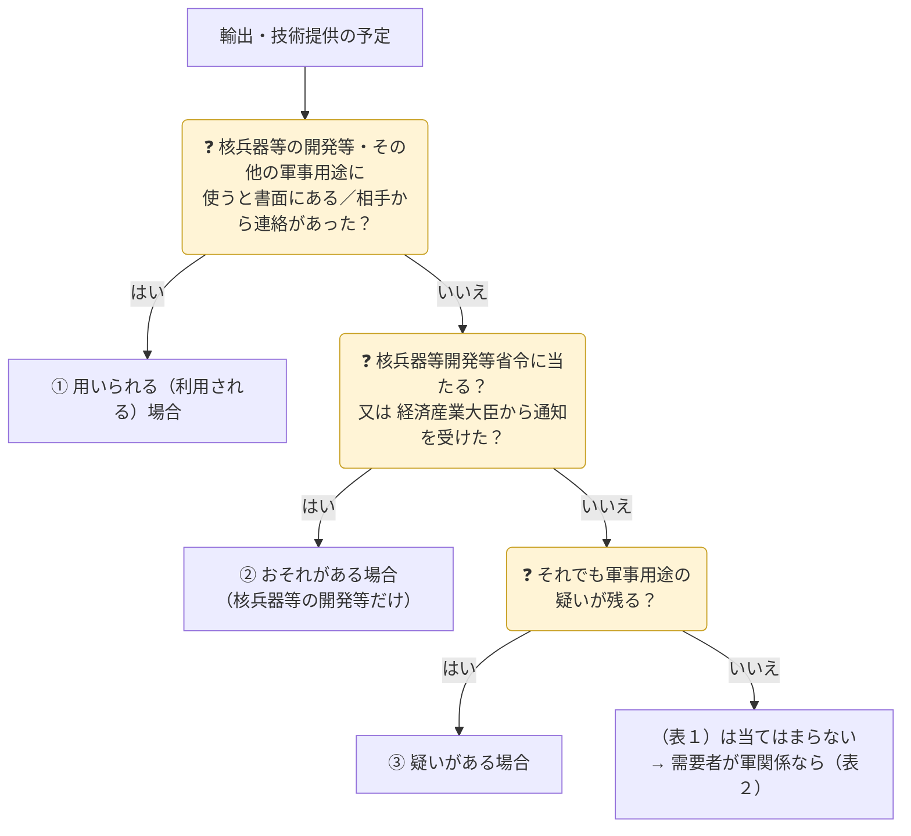

## 個別 vs 包括


{}
| 項目 | 内容 |
|---|---|
| 単位 | 取引（契約）ごと |
| 対象 | 全品目・全仕向地 |
| 審査期間 | 標準処理期間 **90日**（事前相談で短縮・円滑化） |
| 有効期間 | 原則 **6か月** |
| 向いている | 取引が単発、仕向地がグループD、機微度が高い |
{}
{}
| 項目 | 内容 |
|---|---|
| 単位 | 一定の品目・仕向地の組合せをまとめて |
| 対象 | 包括許可の種類ごとに品目・仕向地が限定 |
| 前提 | 輸出管理体制（CP・自己管理チェックリスト 等） |
| 有効期間 | 原則 **3年** |
| 向いている | 同じ品目を継続的・反復的に輸出する |
{}


## 包括許可の種類

下の表の「別表A・別表B」は、法令（政令・省令）の別表ではなく、経済産業省の通達「**包括許可取扱要領**」に付いている別表です。

| 別表 | 名称 | 内容 |
|---|---|---|
| 包括許可取扱要領 別表A | [貨物包括マトリクス](https://www.meti.go.jp/policy/anpo/law_document/tutatu/tutatu24fy/matrix_kamotsu.pdf)（PDF） | 貨物（輸出令別表第1の項番）× 仕向地ごとに、使える包括許可の種類（「一般」など）を示す表 |
| 包括許可取扱要領 別表B | [役務包括マトリクス](https://www.meti.go.jp/policy/anpo/law_document/tutatu/tutatu24fy/matrix_ekimu.pdf)（PDF） | 技術（外為令別表の項番）× 提供地ごとに、同じく示す表 |

| 種類 | 概要 | 主な前提 |
|---|---|---|
| 一般包括許可 | 包括許可取扱要領の別表A・別表Bで「一般」の品目 × グループA（輸出令別表第3）向け | 輸出者等概要・自己管理チェックリストの提出 |
| 特別一般包括許可 | 包括許可取扱要領の別表A・別表Bで「一般」の組合せ（輸出令別表第3の2・第4の地域は除く） | **CP（輸出管理内部規程）の受理**＋チェックリスト |
| 特定包括許可 | 継続的な取引関係にある特定の相手先向け | CP受理 等 |
| 特別返品等包括許可 | 返品・修理品の返送 等 | CP受理 等 |
| 特定子会社包括許可 | 日本企業の海外子会社向け | CP受理 等 |

{}
包括許可の種類・対象品目・対象地域は、通達「**包括許可取扱要領**」と、その<strong>別表A（貨物包括マトリクス）・別表B（役務包括マトリクス）</strong>で定められ、改正されます。申請前に最新版を確認してください（→ [09 関連法令](../09-laws/#包括許可の対象はどこで決まるか)）。
{}

## 特別一般包括許可が効力を失う場合（別表３（１２））

特別一般包括輸出・役務（使用に係るプログラム）取引許可には、包括許可取扱要領の**別表３**で条件が付いています。そのうち<strong>（１２）</strong>は、貨物・技術が核兵器等の開発等やその他の軍事用途に使われる場合、又は需要者が軍関係の場合に、その輸出・取引について包括許可が**失効**するか、**届出**・**報告**が必要になるかを、表で定めています（輸出令別表第1の16の項(1)の貨物とその技術は除きます）。

> 包括許可取扱要領（最終改正：輸出注意事項2025第27号、2026年2月14日施行）の別表３をもとに整理しています。

### 3つの段階：「用いられる」「おそれ」「疑い」

（表１）は、懸念の**確からしさ**を3つの段階に分けています。定義は「2）以外」「2）・3）以外」と書かれているので、**上から順に**当てはめ、最初に当たった段階で判断します。

| 段階 | 当たる場合（別表３の注2）〜4）の要約） | どう判断するか |
|---|---|---|
| **① 用いられる**（利用される）場合 | 核兵器等の開発等やその他の軍事用途に使う旨が、**契約書や入手した文書・データに書かれている**、又は**輸入者・需要者などから連絡を受けた** | 手元の情報で**はっきり分かっている** |
| **② おそれがある**場合 | ①以外で、貨物が<strong>核兵器等開発等省令</strong>（大量破壊兵器等キャッチオールの客観要件。技術は平成13年告示第759号）に当たる、又は核兵器等の開発等に使われるおそれがあると**経済産業大臣から通知**（インフォーム）を受けた | 法令が定めた**基準**（→ [用途要件](../03-catch-all/#用途要件)・[需要者要件](../03-catch-all/#需要者要件)）か、**当局の通知**で決まる |
| **③ 疑いがある**場合 | ①・②以外で、核兵器等の開発等やその他の軍事用途に使われる**疑いがある** | 基準には当たらないが、**懸念が拭えない**（例：軍事関連の需要者が用途を明かさない） |

{}
- 「**おそれ**」は、法令の基準（核兵器等開発等省令）か経済産業大臣の通知で決まる、**形式的な段階**です。定義は**核兵器等の開発等についてだけ**置かれています。
- 「**疑い**」は、そのどちらにも当たらないものの、懸念がある段階です。核兵器等の開発等にも、その他の軍事用途にも使われます。
- そのため、その他の軍事用途には「おそれ」の段階がなく、（表１）の該当欄は**斜線**になっています。
{}

### （表１）段階・仕向地ごとの扱い

| 段階 | 仕向地（提供地） | 核兵器等の開発等 | その他の軍事用途 |
|---|---|---|---|
| ① 用いられる | グループA（輸出令別表第3の地域） | **失効** | 報告 |
| ① 用いられる | グループA以外 | **失効** | **失効** |
| ② おそれ | グループA | **失効**（注２） | ／（斜線） |
| ② おそれ | グループA以外 | **失効** | ／（斜線） |
| ③ 疑い | グループA | 届出 | 報告 |
| ③ 疑い | グループA以外 | 届出 | 届出 |

> 原本では、③の「核兵器等の開発等」の欄は2行をまとめた1つの欄（届出）、②の「その他の軍事用途」の欄は2行をまとめた斜線の欄です。

| 表の記載 | 意味（注１・注２） |
|---|---|
| **失効** | その輸出・取引について特別一般包括許可が効力を失う。**個別許可**が必要 |
| 届出 | その輸出・取引の**前に**経済産業大臣へ届け出る |
| 報告 | その輸出・取引の**後に**内容を経済産業大臣へ報告する |
| 失効（注２） | グループA向けは、核兵器等の開発等に使われるおそれがあると**経済産業大臣から通知を受けたときに限り**失効する（核兵器等開発等省令に当たるだけでは失効しない） |

| 用語（別表３の注1）） | 意味 |
|---|---|
| 核兵器等の開発等 | 核兵器、軍用の化学製剤・細菌製剤、これらの散布装置、これらを運搬できる射程・航続距離300km以上のロケット・無人航空機の開発、製造、使用又は貯蔵 |
| その他の軍事用途 | 輸出令別表第1の**1の項**（武器）の貨物の開発、製造又は使用。ただし、スポーツ・狩猟用の銃、産業用銃、産業用の火薬類などを除き、核兵器等の開発等も除く |

### （表２）需要者が軍・軍関係機関の場合

（表１）のどれにも当たらなくても、需要者（利用する者）が**軍若しくは軍関係機関又はこれらに類する機関**の場合は、仕向地が**グループA以外**なら**届出**が必要です。ただし、ストック販売で需要者が軍関係機関であるおそれが少ないと認められる場合は届出不要です（注３）。病院での医療用、会計・事務処理用など、懸念がないことが明らかな場合も届出は不要です（別表３の注5））。

{}
特別一般包括許可を使える輸出令別表第1の9の項(1)の通信装置を、海外のメーカーに輸出する場合です。

| 仕向地 | 区分 | 用途 | 段階 | （表１）の欄 | 失効するか |
|---|---|---|---|---|---|
| スイス | グループA | その他の軍事用途 | ② おそれ | 斜線 | **失効しない**（その他の軍事用途には「おそれ」の段階がない） |
| インド | グループA以外 | 核兵器等の開発等 | ② おそれ | 失効 | **失効する** |
| フランス | グループA | 核兵器等の開発等 | ③ 疑い | 届出 | **失効しない**（輸出の前に届出が必要） |

同じ「核兵器等の開発等」でも、仕向地（グループAかどうか）と懸念の段階によって結果が変わります。
{}

## 申請の流れ

## 主な提出書類（個別許可の例）

| 書類 | 目的 |
|---|---|
| 輸出許可申請書 | 申請の本体 |
| 申請理由書 | 取引の概要・用途の説明 |
| 契約書・注文書の写し | 取引の実在性 |
| 仕様書・カタログ | 該当項番とスペックの確認 |
| 該非判定書（パラメータシート） | 判定根拠 |
| 需要者の誓約書 | 最終用途・再輸出しない旨の確認 |
| 需要者の概要資料 | 事業内容・懸念の有無の確認 |

{}
- **許可を受ける前に**契約締結はできても、出荷・技術提供はできません。納期は審査期間を見込んで設定します。
- 許可の**条件**（再輸出の制限・報告義務 等）は、出荷後も守る必要があります。
- 申請内容と実際の取引（数量・需要者・仕向地）が違うと、許可の効力が及ばず無許可輸出になり得ます。
{}
