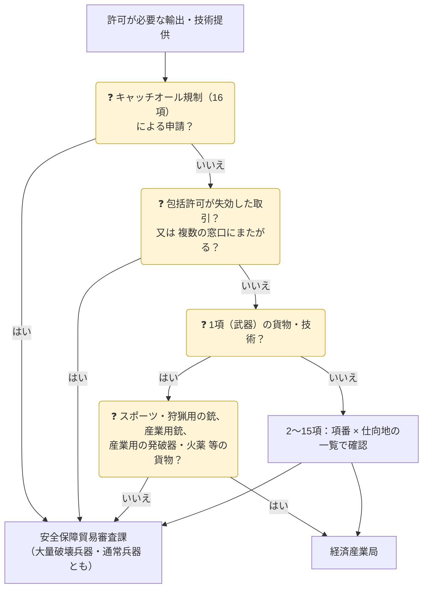

安全保障貿易管理の手続は、経済産業省 貿易経済安全保障局 貿易管理部の**安全保障貿易管理課**・**安全保障貿易審査課**・**安全保障貿易検査官室**などが分担しています。許可申請の窓口は、本省の**安全保障貿易審査課**（NACCS の窓口コード GSI）と、各地の**経済産業局**（通商事務所・沖縄総合事務局を含む）に分かれています。どちらに出すかは申請者が選ぶのではなく、**手続の種類**と、**該当項番 × 仕向地（提供先国）の組合せ**で決まっています。

> 経済産業省「安全保障貿易管理」トップページ、「各課室への電話による問い合わせ」（最終更新 2026年2月13日）、「安全保障貿易審査課のお問い合わせ先」（同 2025年11月26日）、「電子申請について」（同 2026年4月23日）、「貨物における個別許可申請（新規）」「役務における個別許可申請（新規）」（いずれも同 2026年4月22日）、「仕向地」（同 2026年6月3日）、「包括許可申請（新規・変更・更新）、関連手続き」（同 2026年4月30日）、「補完的輸出規制（キャッチオール規制）」、「企業等の自主管理の促進」、「安全保障貿易に関する事後審査」（同 2026年4月6日）、「技術管理強化のための官民対話スキーム」をもとに、2026年10月26日時点で整理しています。

## 経済産業省の担当課室

| 課室 | 担当（窓口になる手続・問合せ） | 電話 | メール |
|---|---|---|---|
| **安全保障貿易管理課** | 安全保障貿易管理の制度概要、外為法上の安全保障貿易管理に関する**法令解釈**の質問 | 03-3501-2800 | bzl-qqfcbh |
| **安全保障貿易審査課** | 個別許可・包括許可の**申請・審査**（本省が窓口のもの） リスト規制・キャッチオール規制・包括許可の申請手続の質問 **キャッチオール規制の事前相談** 許可証の訂正など許可後の手続の相談 | 03-3501-2801 | 下の表 |
| **安全保障貿易検査官室** | 輸出者等遵守基準・輸出管理内部規程（**CP**）の質問 **不正輸出の連絡** 無許可輸出・税関への申告不備が判明したときの**事後審査**（通報の受付） | 03-3501-2841 | bzl-qqfcbh（質問） bzl-jigo-shinsa（事後審査） |
| 電子化・効率化推進室 | NACCS で申請する前の**申請者届出** | ― | ― |

電話の受付時間は、いずれも 9:30〜17:00（12:00〜13:00を除く）です。メールアドレスのドメインはすべて「（アットマーク）meti.go.jp」です。

### 安全保障貿易審査課のメール窓口

| 内容 | メール | 書くこと・注意 |
|---|---|---|
| リスト規制などの問合せ（下の行以外）、キャッチオール規制の制度概要などの一般的な問合せ | bzl-qqfcbf | 申請前：貨物・技術の政令・省令の該当項番と仕向地を必ず書く 許可後：許可番号（紙の許可証なら写し）を必ず付ける |
| **キャッチオール規制**の個別の取引案件の**事前相談** | bzl-anposhinsa-catchall | 準備する書類は[事前相談](#事前相談キャッチオール規制)を参照 |

HTML形式のメールは受信できず、1通10MBまでです。メールへの回答には2〜3週間以上かかることがあります。経済産業省は**該非判定の確認や申請書類の事前確認は行わず**、審査の進捗の問合せも控えるよう求めています。

### 申請・届出・報告の提出先（許可申請以外）

| 手続 | 提出先 | 補足 |
|---|---|---|
| CP（輸出管理内部規程）の新規届・内容変更届・取下げ届 | CP専用メール bzl-CP | 届け出は任意。適切なら CP受理票が出る。軽微な改正で提出が要るかは検査官室に相談 |
| 輸出者等概要・自己管理チェックリスト（CL）、受理票の記載事項変更届、CP実施状況の公表の宣言書 | CL専用メール bzl-CL | CP受理票を受けた者は**毎年7月1日〜31日**に CL を提出 |
| 無許可輸出等の通報（事後審査） | 安全保障貿易検査官室 事後審査担当 bzl-jigo-shinsa | 件名「無許可輸出等について（輸出者名等）」。案件調査票（Excel）・輸出関連書類一式を付ける（→ [08 違反事例](../../08-penalties-cases/)） |
| 税関への輸出申告の不備（許可証・特例適用の申告漏れなど） | 同上 | 税関にも報告する。件名「申告不備について（輸出者名等）」 |
| 重要管理対象技術を提供する取引の**事前報告** | 専用メール bzl-gijutsukanri-jizenhokoku | 契約締結の前に報告（→ [重要技術の事前報告](../../09-laws/critical-tech-report/)） |
| NACCS の利用申込み | NACCSセンター | システムの操作方法の問合せも NACCSセンター |
| NACCS 外為法関連業務の申請者届出 | 電子化・効率化推進室 | 利用申込みの後に行う |

## 早見表

| 手続 | 申請窓口 | 補足 |
|---|---|---|
| **キャッチオール規制**（16項）の個別許可 大量破壊兵器等・**通常兵器**とも、貨物・技術とも | **安全保障貿易審査課** | 仕向地は輸出令別表第3（グループA）以外の全地域。16項(1)の特定品目も同じ。提出書類は大量破壊兵器用と通常兵器用で別 |
| キャッチオール規制の**事前相談** | **安全保障貿易審査課**（専用メール） | 申請が必要か判断に迷う場合を含む（→ [メール窓口](#安全保障貿易審査課のメール窓口)） |
| <strong>1項（武器）</strong>の貨物 | 原則 **安全保障貿易審査課** | スポーツ用・狩猟用の銃、産業用銃、産業用の発破器・火薬などは**経済産業局** |
| 1項の技術 | **安全保障貿易審査課** | 全地域 |
| 2〜15項の貨物・技術 | 項番 × 仕向地で分かれる | おおむね、**グループA向け＝経済産業局**、それ以外の地域や機微度の高い品目＝**安全保障貿易審査課**（→ [項番・仕向地ごとの一覧](#項番仕向地ごとの申請窓口個別許可)） |
| 特定記録媒体等輸出等許可（1〜16項） | **安全保障貿易審査課** | 全地域 |
| 複数の窓口にまたがる案件 | **安全保障貿易審査課**にまとめて申請できる | |
| 包括許可が**失効**した輸出・取引の個別許可 | **安全保障貿易審査課** | 包括許可の条件により、核兵器等の開発等・軍事用途に関連して効力を失った場合（→ [別表３（１２）](../#特別一般包括許可が効力を失う場合別表３１２)） |
| 一般包括許可・特別一般包括許可 | **経済産業局** | NACCS で申請 |
| 特定包括許可 | **安全保障貿易審査課** | NACCS で申請 |
| 特別返品等包括許可・特定子会社包括許可・展示会等包括役務取引許可 | **安全保障貿易審査課** | メール又は郵送 |

{}
- 個別許可・包括許可（一般包括・特別一般包括・特定包括）の申請は、<strong>電子申請（NACCS 外為法関連業務）</strong>で行い、送信時に申請窓口を選びます。2022年7月以降、輸出許可申請は電子申請のみです（紙で発給された許可の有効期限の延長・内容変更などの一部手続を除く）。
- 初めて使う場合は、NACCS センターへの利用申込みと、経済産業省への申請者届出が先に必要です。
- 許可証の**訂正・変更**の申請は、原則として**その許可をした機関**に出します。
{}

## キャッチオール規制の申請窓口（大量破壊兵器・通常兵器）

| 項目 | 内容 |
|---|---|
| 申請先 | 経済産業省 安全保障貿易審査課（NACCS の窓口コード GSI） |
| 対象 | 16項の貨物・技術（食料品・木材などを除くほぼすべて）。**大量破壊兵器キャッチオール**・**通常兵器キャッチオール**のどちらも同じ窓口。客観要件（用途要件・需要者要件）に当たる場合も、インフォーム通知を受けた場合も同じ |
| 仕向地 | 輸出令別表第3（グループA）**以外**の全地域 |
| 提出書類 | 大量破壊兵器用・通常兵器用で別のセット（経済産業省の[貨物](https://www.meti.go.jp/policy/anpo/apply-01/shinseishorui/kobetu/kamotu/)・[技術](https://www.meti.go.jp/policy/anpo/apply-01/shinseishorui/kobetu/ekimu/)のページの16項欄） |
| 経済産業局 | キャッチオール規制の申請は**受け付けない**（窓口一覧で16項はすべて安全保障貿易審査課） |

### 事前相談（キャッチオール規制）

申請が必要かどうか判断が難しい場合を含め、安全保障貿易審査課に相談できます（→ [キャッチオール規制](../../03-catch-all/)）。

| 項目 | 内容 |
|---|---|
| 送り先 | bzl-anposhinsa-catchall（アットマーク）meti.go.jp |
| 準備する書類 | (1) 貨物の商流・物流・契約の内容・用途がわかる資料（様式自由） (2) カタログ又は仕様書などの技術資料 (3) 需要者などの事業内容に関する資料 (4) キャッチオール規制の申請要件に当たるかを確認した審査票（[客観要件確認シート](https://www.meti.go.jp/policy/anpo/catch-all/20251009_checksheet_tsujoheikifukumu.docx)） |
| 注意 | 必要に応じて他の書類を求められることがある。HTML形式のメールは受信できず、1通10MBまで |

## 項番・仕向地ごとの申請窓口（個別許可）

表の「局」は**最寄りの経済産業局**、「審査課」は**安全保障貿易審査課**です。括弧内は提出書類の区分（経済産業省の一覧の記号）です。仕向地の「い地域①」などは、経済産業省が申請窓口・提出書類を分けるために使っている区分です（→ [仕向地の区分](#仕向地の区分)）。


{}
| 項番 | 対象 | 仕向地 → 窓口（書類） |
|---|---|---|
| 1項 | (1)のスポーツ用・狩猟用の空気銃・散弾銃・ライフル銃・火縄式銃砲、救命銃・もり銃・リベット銃などの産業用銃、これらの銃砲弾（スポーツ・狩猟用）・附属品（暗視装置を除く）・部分品／(2)の産業用の発破器／(3)の産業用の火薬・爆薬・火工品 | 全地域 → **局**（E2） |
| 1項 | 上記以外 | 全地域 → **審査課**（E1） |
| 2項 | (3)(4)(6)(8)(10)のうち、貨物等省令第1条第三号（原子炉用を除く）・第四号ロ・第六号（リチウム同位元素分離用の装置）・第八号ロ・第十号ロ | い地域① → **局**（A）／い地域② → **局**（B1） |
| 2項 | (1)〜(8)・(10)・(10の2)（上記を除く） | い地域①・② → **審査課**（B1） |
| 2項 | (1)〜(8)・(10)・(10の2) | ろ地域 → **審査課**（C） |
| 2項 | (9)・(11)〜(52) | い地域① → **局**（A）／ろ地域 → **審査課**（C） |
| 2項 | (9)・(11)〜(52)のうち、告示で定める貨物・14項の貨物 | い地域② → **審査課**（B2） |
| 2項 | (9)・(11)〜(52)のうち、15項の貨物 | い地域② → **審査課**（C） |
| 2項 | (9)・(11)〜(52)（告示で定める貨物・14項・15項を除く） | い地域② → **局**（B1） |
| 3項(1) | 貨物等省令第2条第1項第一号 | い地域① → **局**（A）／は地域① → **局**（B1）／に地域① → **審査課**（D1） |
| 3項(1) | 同第三号イ〜ホ | い地域①・は地域① → **審査課**（B1）／は地域② → **審査課**（D2） |
| 3項(1) | 同第二号、第三号ヘ〜ヤ | い地域① → **局**（A）／は地域① → **局**（B1） |
| 3項(1) | 同第二号イ〜ハ、第三号ヘ〜タ | は地域② → **審査課**（D3） |
| 3項(1) | 同第二号ニ〜ト、第三号レ〜ヤ | は地域② → **審査課**（D3）／に地域② → **審査課**（D4） |
| 3項(2)(3) | すべて | い地域① → **局**（A）／は地域① → **局**（B1）／に地域① → **審査課**（D5） |
| 3の2項 | すべて | い地域① → **局**（A）／は地域① → **局**（B1）／に地域① → **審査課**（(1)はD6、(2)はD5） |
| 4項 | (1)(1の2)(2) | い地域①・ほ地域 → **審査課**（B1）／へ地域 → **審査課**（C） |
| 4項 | (3)〜(26) | い地域① → **局**（A）／へ地域 → **審査課**（C） |
| 4項 | (3)〜(26)のうち、告示で定める貨物・14項又は15項の貨物・(22)のうち貨物等省令第7条第三号ロ | ほ地域 → **審査課**（C） |
| 4項 | (3)〜(26)（上記を除く） | ほ地域 → **局**（B1） |
| 5〜13項 | 下の行（告示で定める貨物、7項・8項・10項の特定の貨物）以外 | と地域① → **局**（A）※2／ち地域 → **審査課**（C） |
| 5〜13項 | 告示で定める貨物／7項(1)(2)(10の2)(15の3)〜(17)(18)(22)〜(25)の特定の貨物／8項のうち貨物等省令第7条第三号ロ・ハ、第六号、第七号／10項(14)のうち貨物等省令第9条第十六号イ・ロ | い地域① → **局**（A）／と地域② → **審査課**（B2）／ち地域 → **審査課**（C） |
| 14項 | すべて | い地域① → **局**（A）／と地域② → **審査課**（B2）／ち地域 → **審査課**（C） |
| 15項 | すべて | い地域① → **局**（A）／と地域②・ち地域 → **審査課**（C） |
| **16項** | **キャッチオール規制対象品** | 別表第3以外の全地域 → **審査課**（大量破壊兵器用／通常兵器用の書類） |

- ※1 輸出令第4条第1項第一号の外国向け仮陸揚げ貨物を、別表第3以外の地域へ輸出する場合で、同号イ又はロに当たるものは、**審査課**。
- ※2 5〜13項・15項の貨物で総価額100万円（別表第3の3の貨物は5万円）以下のもの（外国向け仮陸揚げ貨物を除く）を、別表第3・別表第4以外の地域へ輸出する場合で、輸出令第4条第1項第三号イ・ロ・ニのいずれか（別表第3の2の地域（イラク・北朝鮮を除く）向けは同号イ〜ニのいずれか）に当たるもの（少額特例が使えない場合）は、**審査課**。
{}
{}
「別1－2(3)」は、輸出令別表第1の2の項(3)の貨物に係る技術を指します。

| 項番 | 対象 | 提供先国 → 窓口（書類） |
|---|---|---|
| 1項 | すべて | 全地域 → **審査課**（TE） |
| 2項(1) | 別1－2(1)〜(8)・(10)・(10の2)のうち、貨物等省令第1条第一号〜第五号（第三号の試薬・標準物質と第四号ロを除く）・第六号（核燃料物質の成型加工用）・第七号・第八号イ・第十号イ・第十号の二・第十号の三 | い地域①・② → **審査課**（TB1）／ろ地域 → **審査課**（TC） |
| 2項(1) | 別1－2(3)(4)(6)(8)(10)のうち、第1条第三号の試薬・標準物質（使用に係る技術に限る）・第四号ロ・第六号（リチウム同位元素分離用）・第八号ロ・第十号ロ | い地域① → **局**（TA）／い地域② → **局**（TB1）／ろ地域 → **審査課**（TC） |
| 2項(1) | 別1－2(3)のうち、第1条第三号の試薬・標準物質（使用に係る技術を除く） | い地域① → **審査課**（TB1）／い地域② → **審査課**（TB2）／ろ地域 → **審査課**（TC） |
| 2項(1) | 別1－2(9)・(11)〜(52)のうち15項の貨物、2(17)2のうち貨物等省令第14条第一号 | い地域① → **審査課**（TB1）／い地域②・ろ地域 → **審査課**（TC） |
| 2項(1) | 付表に掲げる技術、14項の貨物に係る技術 | い地域① → **局**（TA）／い地域② → **審査課**（TB2）／ろ地域 → **審査課**（TC） |
| 2項(1) | 別1－2(9)・(11)〜(52)（上の2行を除く） | い地域① → **局**（TA）／い地域② → **局**（TB1）／ろ地域 → **審査課**（TC） |
| 2項(2) | すべて | い地域① → **局**（TA）／い地域② → **局**（TB1）／ろ地域 → **審査課**（TC） |
| 3項(1) | 貨物等省令第2条第1項第一号 | い地域① → **局**（TA）／は地域① → **審査課**（TB1）／に地域① → **審査課**（TD1） |
| 3項(1) | 同第三号イ〜ホ | い地域①・は地域① → **審査課**（TB1）／は地域② → **審査課**（TD2） |
| 3項(1) | 同第二号、第三号ヘ〜ヤ | い地域① → **局**（TA）／は地域① → **審査課**（TB1） |
| 3項(1) | 同第二号イ〜ハ、第三号ヘ〜タ | は地域② → **審査課**（TD2） |
| 3項(1) | 同第二号ニ〜ト、第三号レ〜ヤ | は地域② → **審査課**（TD2）／に地域② → **審査課**（TD3） |
| 3項(2) | すべて | い地域① → **局**（TA）／は地域① → **局**（TB1）／に地域① → **審査課**（TC） |
| 3の2項(1) | すべて | い地域① → **審査課**（TB1）／は地域①・に地域① → **審査課**（TD4） |
| 3の2項(2) | すべて | い地域① → **局**（TA）／は地域① → **局**（TB1）／に地域① → **審査課**（TC） |
| 4項(1) | 別1－4(1)(1の2)(2)(3)1のうち、貨物等省令第3条第一号・第一号の二・第一号の三・第二号 | い地域①・ほ地域 → **審査課**（TB1） |
| 4項(1) | 別1－4(3)〜(26)（15項の貨物、第3条第二号イ(二)(三)を除く） | い地域① → **局**（TA） |
| 4項(1) | 別1－4(3)〜(26)のうち15項の貨物 | い地域① → **審査課**（TB1） |
| 4項(1) | 別1－4(3)〜(26)（付表に掲げる技術、14項・15項の貨物、第3条第二号イ(二)(三)を除く） | ほ地域 → **局**（TB1） |
| 4項(1) | 別1－4(3)〜(26)のうち、付表に掲げる技術、14項・15項の貨物 | ほ地域 → **審査課**（TC） |
| 4項(1) | 別1－4(1)〜(26) | へ地域 → **審査課**（TC） |
| 4項(2)〜(5) | すべて | い地域① → **局**（TA）／ほ地域 → **局**（TB1）／へ地域 → **審査課**（TC） |
| 5〜13項 | 付表に掲げる技術を除く | と地域① → **局**（TA）／ち地域 → **審査課**（TC） |
| 5〜13項 | 付表に掲げる技術 | い地域① → **局**（TA。別表2の付表2の1(ロ)・2(ロ)・4・5(ロ)はTB1）／と地域② → **審査課**（TB2）／ち地域 → **審査課**（TC） |
| 14項 | すべて | い地域① → **局**（TA）／と地域② → **審査課**（TB2）／ち地域 → **審査課**（TC） |
| 15項 | すべて | い地域① → **審査課**（TB1）／と地域②・ち地域 → **審査課**（TC） |
| 特定記録媒体等 | 1〜16項 | 全地域 → **審査課**（G。懸念がある場合のみ用意） |
| **16項** | **キャッチオール規制対象** | 別表第3以外の全地域 → **審査課**（大量破壊兵器用／通常兵器用の書類） |

技術の3項(1)・4項(1)・15項は、同じ項番の貨物より**審査課**になる範囲が広くなっています（例：15項の技術は、い地域①向けでも審査課）。
{}


{}
- 窓口は品目の**細目**（貨物等省令の号）と仕向地の組合せで細かく分かれています。上の表は経済産業省の一覧を整理したものなので、申請前に必ず原本（[貨物](https://www.meti.go.jp/policy/anpo/apply-01/shinseishorui/kobetu/kamotu/)・[技術](https://www.meti.go.jp/policy/anpo/apply-01/shinseishorui/kobetu/ekimu/)）で確認してください。
- 1件の申請で複数の窓口にまたがる場合は、安全保障貿易審査課にまとめて申請できます。
{}

### 仕向地の区分

経済産業省の「[仕向地](https://www.meti.go.jp/policy/anpo/apply08.html)」のページの区分です。法令上の国グループではありません。

| 区分 | 国・地域 |
|---|---|
| い地域① | 輸出令別表第3の27か国（グループA。→ [国グループ](../../01-overview/#4-国グループ仕向地の区分)） |
| い地域② | アイスランド、ウクライナ、エストニア、カザフスタン、キプロス、クロアチア、スロバキア、スロベニア、トルコ、ブラジル、マルタ、南アフリカ共和国、メキシコ、ラトビア、リトアニア、ルーマニア |
| ろ地域 | い地域①・②**以外**のすべて（その他の地域を含む） |
| は地域① | アイスランド、インド、ウクライナ、エストニア、キプロス、クロアチア、スロバキア、スロベニア、トルコ、マルタ、メキシコ、ラトビア、リトアニア、ルーマニア |
| は地域② | い地域①・は地域①・に地域②**以外** |
| に地域① | い地域①・は地域①**以外**のすべて（その他の地域を含む） |
| に地域② | アンゴラ、イスラエル、エジプト、北朝鮮、コソボ、シリア、ソマリア、台湾、南スーダン、ミャンマー、その他の地域 |
| ほ地域 | アイスランド、インド、ウクライナ、トルコ、ブラジル、南アフリカ共和国 |
| へ地域 | い地域①・ほ地域**以外**のすべて（その他の地域を含む） |
| と地域① | ち地域**以外**のすべて（い地域①を含む） |
| と地域② | い地域①・ち地域**以外**のすべて |
| ち地域 | 輸出令別表第3の2の10か国・地域、イラン、ベラルーシ、ロシア |

> 「以外」の区分は、経済産業省のページの国名一覧を照らし合わせてまとめたものです。正確な国名は原本で確認してください。

## 包括許可の申請窓口

| 包括許可 | 申請方法 | 申請窓口 |
|---|---|---|
| 一般包括許可（貨物・役務） | NACCS | **経済産業局** |
| 特別一般包括許可（貨物・役務） | NACCS | **経済産業局** |
| 特定包括許可（貨物・役務） | NACCS | **安全保障貿易審査課** |
| 特別返品等包括許可（貨物・役務） | メール又は郵送 | **安全保障貿易審査課** |
| 特定子会社包括許可（貨物・役務） | メール又は郵送 | **安全保障貿易審査課** |
| 展示会等包括役務取引許可（役務） | メール又は郵送 | **安全保障貿易審査課** |

包括許可の種類と要件は、[06 許可申請](../#包括許可の種類)を参照してください。

## 申請窓口の一覧と「最寄りの経済産業局」

「経済産業局」が窓口の申請は、**申請者の店舗又は営業所の所在地を管轄する**経済産業局等（通商事務所・沖縄総合事務局を含む）に出します。ただし、【全国から申請可】の5つは**所在地にかかわらず**申請できます。

| 区分 | 窓口 | 所在地 |
|---|---|---|
| 本省 | 貿易経済安全保障局 貿易管理部 安全保障貿易審査課（GSI） | 〒100-8901 東京都千代田区霞が関1-3-1 |
| 経済産業局 | 北海道経済産業局 総務企画部 国際課 | 〒060-0808 札幌市北区北八条西2丁目1番1（札幌第一合同庁舎） |
| 経済産業局 | 東北経済産業局 総務企画部 国際課 | 〒980-8403 仙台市青葉区本町3の3の1（仙台合同庁舎） |
| 経済産業局 | 関東経済産業局 総務企画部 国際課 貿易管理室（TKY）【全国から申請可】 | 〒330-9715 さいたま市中央区新都心1-1（さいたま新都心合同庁舎1号館9階） |
| 経済産業局 | 中部経済産業局 地域経済部 国際課（NAG）【全国から申請可】 | 〒460-8510 名古屋市中区三の丸2の6の2（名古屋第4地方合同庁舎5階） |
| 経済産業局 | 近畿経済産業局 国際部 通商課（OSA）【全国から申請可】 | 〒540-8535 大阪市中央区大手前1の5の44（大阪合同庁舎1号館） |
| 経済産業局 | 中国経済産業局 産業部 国際課 | 〒730-8531 広島市中区上八丁堀6の30（広島合同庁舎2号館） |
| 経済産業局 | 四国経済産業局 産業部 産業振興課 | 〒760-8512 高松市サンポート3-33（高松サンポート合同庁舎） |
| 経済産業局 | 九州経済産業局 国際部 国際課 | 〒812-8546 福岡市博多区博多駅東2の11の1（福岡合同庁舎） |
| 通商事務所 | 横浜通商事務所 輸出課（YEX）【全国から申請可】 | 〒231-0001 横浜市中区新港一丁目6番1号（よこはま新港合同庁舎3階） |
| 通商事務所 | 神戸通商事務所 総務課（KOB）【全国から申請可】 | 〒650-0024 神戸市中央区海岸通29番地（神戸地方合同庁舎5階） |
| 沖縄総合事務局 | 沖縄総合事務局 経済産業部 商務通商課 | 〒900-8530 那覇市おもろまち2丁目1番1号 |

括弧内は NACCS の窓口コードです（経済産業省の一覧に載っているものだけ）。

{}
- <strong>対面受付はありません。</strong>電子申請（NACCS）で、該当項番・仕向地の一覧で指定された窓口を選んで申請します。
- 申請窓口を**間違えると**、いったん申請を取り下げて正しい窓口に再申請しなければなりません。**申請日も再申請の日**になります。
- 上の一覧は経済産業省「[電子申請について](https://www.meti.go.jp/policy/anpo/apply-01/naccs.html)」（2026年4月23日更新）によります。別ページの「[経済産業局・通商事務所 窓口一覧](https://www.meti.go.jp/policy/anpo/link1.html)」には、中部経済産業局の移転前の住所や近畿経済産業局の旧課名など、古い情報が残っています。
{}
