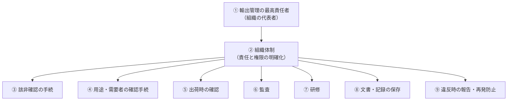

## 輸出者等遵守基準（法令上の義務）

| 基準 | 対象者 | 求められること |
|---|---|---|
| **基準1** | 業として輸出・技術提供を行う**全ての者** | ① 該非確認の責任者を選任 ② 業務従事者への法令遵守の指導 |
| **基準2** | リスト規制品を**反復継続して**輸出・提供する者 | 基準1に加えて、下の9項目の体制 |

## 遵守基準省令と外為法等遵守事項

CP を経済産業省に届け出る企業は、遵守基準省令に加えて、CP通達の**外為法等遵守事項**を全て含む内部規程を定めます。経済産業省は、これを「遵守基準省令より一段厳しい」内部規程と位置づけています。

| | 遵守基準省令 | 外為法等遵守事項 |
|---|---|---|
| 法令上の位置づけ | 経済産業省令（[輸出者等遵守基準を定める省令](https://laws.e-gov.go.jp/law/421M60000400060)、平成21年経済産業省令第60号）。外為法第55条の10第1項に基づく | 通達「輸出管理内部規程の届出等について」（CP通達。輸出注意事項17第9号、最終改正 輸出注意事項2025第10号）の**別紙１** |
| 誰にかかるか | 業として輸出・技術提供を行う全ての輸出者等（基準1）、特定重要貨物等の輸出者等（基準2） | CP を経済産業省に届け出る企業（届出は任意） |
| 守らなかった場合 | 経済産業大臣の指導・助言、勧告、命令（命令違反は罰則） | CP の受理の要件を満たさない |

### 省令の努力規定は、遵守事項では義務になる

遵守基準省令の基準2のうち、監査・研修・子会社の指導等・文書保存の4つは「努めること」という**努力規定**です。外為法等遵守事項は、この4つも「〜すること」という**義務**として定めています。

| 事項 | 遵守基準省令 第1条第二号 | 外為法等遵守事項 |
|---|---|---|
| 監査 | ヘ：監査の体制と手続を定め、定期的に実施する**よう努める** | 4：監査の体制と手続を定め、定期的に実施する |
| 研修 | ト：統括責任者と業務従事者に研修を行う**よう努める** | 5：指導を行うとともに、研修を実施する |
| 子会社の指導等 | チ：子会社への指導・研修・業務の確認を定期的に行う**よう努める** | 7：定期的に行う。関連会社への指導も加わる |
| 文書保存 | リ：文書・図画・電磁的記録を適切な期間保存する**よう努める** | 6：少なくとも**7年間**（5〜16項の貨物・技術は少なくとも**5年間**）保存する |

> 遵守基準省令は e-Gov の条文、外為法等遵守事項は経済産業省「企業等の自主管理の促進」に掲載の別紙１で確認（2026年10月26日時点）。

## CP（輸出管理内部規程）の構成例

| 章 | 内容 | 担当の例 |
|---|---|---|
| 基本方針 | 法令遵守・大量破壊兵器等への不関与 | 経営層 |
| 組織 | 最高責任者・輸出管理部門・各部門の役割 | 経営層・管理部門 |
| 該非確認 | 判定手順・二重チェック・判定書の管理 | 技術部門 → 管理部門 |
| 取引審査 | 用途・需要者の確認、懸念時のエスカレーション | 営業部門 → 管理部門 |
| 出荷管理 | 現品・書類・許可条件の照合 | 物流部門 |
| 技術管理 | 技術資料の分類・アクセス権・出張時の持出し | 技術部門・情報システム |
| 監査 | 定期監査・是正 | 監査部門 |
| 教育 | 階層別・部門別研修 | 管理部門 |
| 記録保存 | 保存対象・期間・方法 | 全部門 |
| 違反時の対応 | 経産省への報告、原因分析、再発防止 | 経営層・管理部門 |

{}
CPを経済産業省に届け出て**受理**されると、特別一般包括許可などの前提を満たせます。受理後も毎年の**自己管理チェックリスト**の提出が必要です。
{}

## 記録保存

| 保存するもの | 保存期間の目安 |
|---|---|
| 法定の帳簿（許可に基づく輸出・提供の記録 等） | 法令で定める期間（**7年**） |
| 該非判定書・取引審査の記録・出荷記録 | 遵守基準省令では「適切な期間」（努力規定）。CP 届出企業は外為法等遵守事項により、輸出・提供の時から**少なくとも7年間**（5〜16項の貨物・技術は**少なくとも5年間**） |
| 許可証・申請書類 | 許可の有効期間終了後も一定期間 |

{}
- 原則：輸出関連書類等を、貨物の輸出時・技術の提供時から**少なくとも7年間**保存する。
- 輸出令別表第1・外為令別表の5〜16の項の貨物・技術：**少なくとも5年間**。
- 特別一般包括許可を受けた者が、包括許可取扱要領に定める**返送**に当たるものとして輸出・提供した場合（2〜15の項か16の項か明らかでないものの返送を含む）：一律**7年間**。
- 全ての輸出関連書類等に、事実を正確に記載・記録することも求められます。
{}

{}
- 判定書は残っているが、**判定の根拠資料**（仕様書の版数・スペック値）が残っていない
- 省令改正後に**再判定**していない
- 技術資料の**社外持出し・メール送信**が管理の対象外になっている
{}
