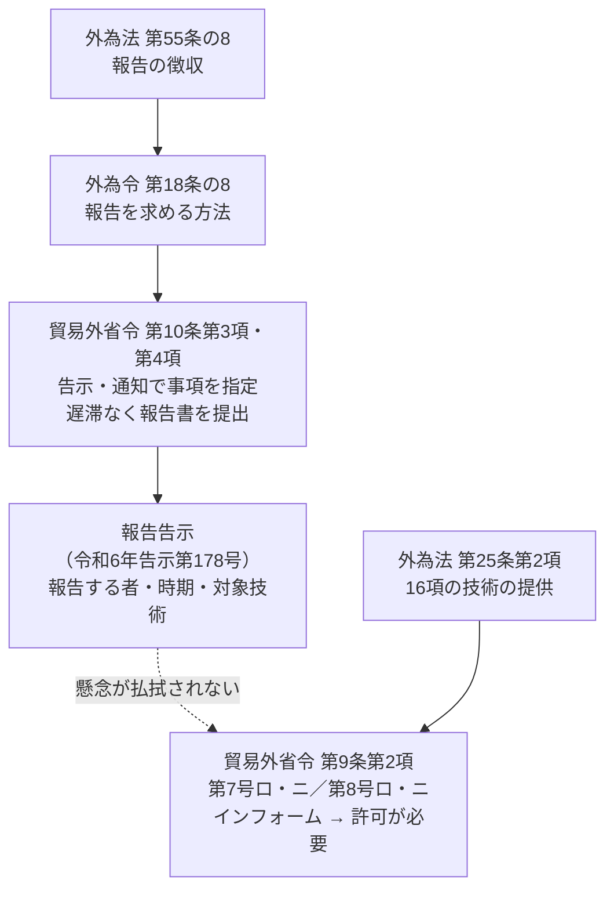
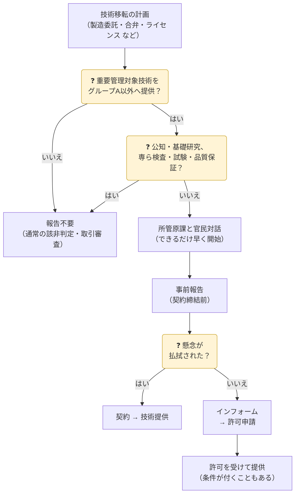

「貿易関係貿易外取引等に関する省令第十条第三項の規定に基づく重要管理対象技術を提供することを目的とする取引を行おうとする者に報告を求める事項」（令和6年経済産業省告示第178号。以下「報告告示」）は、**重要管理対象技術**をグループA以外の外国に提供する取引について、**契約を結ぶ前に経済産業大臣へ報告する**ことを求める告示です。経済産業省は、この報告を入口に官民で対話する仕組みを「**技術管理強化のための官民対話スキーム**」と呼んでいます。

> 経済産業省の告示案・概要資料（e-Gov パブリック・コメント、2024年9月・2026年10月）と、2024年10月30日公表の意見公募の結果をもとに、2026年10月18日時点で整理しています。説明は本サイトによる要約です。

{}
- 対象は**リスト規制に当たらない16項の技術**のうち、告示で指定した技術（2026年8月16日から**24技術**）です。
- 対象は各技術の**設計又は製造に係る技術**です。**使用の技術**（据付・操作・保守など）は対象外です。
- 報告するのは**技術を提供する取引**です。対象技術に関係する製品（貨物）を**輸出**するだけなら報告は不要で、通常のキャッチオール規制で確認します（→ [03 キャッチオール規制](../../03-catch-all/)）。
- 提供先が**グループA（輸出令別表第3）以外**の外国・外国の非居住者の場合に報告します。
- 報告は**許可申請ではありません**。ただし、対話で懸念が払拭されなければ**インフォーム**（許可申請をすべき旨の通知）が出され、許可が必要になります。
- 目的は技術移転を止めることではなく、**移転後の管理**を徹底すること（経済産業省の説明）です。
{}

## 根拠となる法令

| 法令 | 条 | 役割 |
|---|---|---|
| 外為法 | 第55条の8 | 主務大臣は、法の目的の達成に必要な限度で、取引を行う者などに報告を求められる（→ [外為法の構造](../foreign-exchange-act/)） |
| 外為令 | 第18条の8 | 報告を求める方法（→ [外為令の構造](../foreign-exchange-order/)） |
| 貿易外省令 | 第10条第3項・第4項 | 報告を求める事項を**告示**又は通知で示す。命令を受けた者は**遅滞なく**報告書を提出する（「告示」は2024年10月30日の改正で追加） |
| 貿易外省令 | 第9条第2項第7号ロ・ニ、第8号ロ・ニ | インフォームの規定。「提供を受けた者がその技術の情報を**適切に管理しない場合に生ずるおそれ**」を含むと明記（2024年10月30日の改正で括弧書きを追加） |
| 外為法 | 第71条 | 報告をしない・虚偽の報告をした場合の罰則（**6か月**以下の拘禁刑又は**50万円**以下の罰金） |

{}
報告告示は**報告**を求めるだけで、提供を禁止したり許可を求めたりはしません。許可が必要になるのは、報告をきっかけに経済産業省が**インフォーム**を出した場合です。インフォームを受けた後の扱いは、通常のキャッチオール規制と同じです（→ [03 インフォーム要件](../../03-catch-all/#インフォーム要件)）。
{}

## 告示の構成

報告告示は2つの号と別紙様式でできています。

| 部分 | 内容 |
|---|---|
| **第一号** | 報告する者、報告の時期・方法、報告しなくてよい取引 |
| **第二号** | 「重要管理対象技術」の定義と、対象技術の一覧（イ、ロ、ハ…の分野ごとに（一）（二）…の細目） |
| 別紙様式 | 報告書の様式（1枚） |

### 第一号：だれが、いつ報告するか

| 項目 | 内容 |
|---|---|
| 報告する者 | ① 外国法人への**出資・製造委託その他の事業活動**に伴い、重要管理対象技術を**外国で提供**する取引を行おうとする**居住者又は非居住者** ② 重要管理対象技術を**外国の非居住者に提供**する取引を行おうとする**居住者** |
| 「外国」の範囲 | **輸出令別表第3に掲げる地域（グループA）以外**の外国 |
| 時期 | 取引に係る**契約を締結する前** |
| 方法 | 別紙様式の報告書を経済産業大臣に提出 |
| 報告しなくてよい取引 | イ 貿易外省令第9条第2項の許可不要の取引（**公知の技術・基礎科学分野の研究** など。インフォームの号を除く） ロ **専ら検査・試験・品質保証**を可能とする技術の提供など、懸念が少ないことが明らかな取引 |

{}
- **出資そのもの**は報告の対象ではありません。報告するのは技術を提供する取引です。
- 「外国で提供」は相手が**外国で技術を受け取る**取引、「外国の非居住者に提供」は**受け取る場所を問わず**居住者が外国の非居住者に提供する取引です（外為法第25条第1項と同じ整理）。
- 日本企業の**海外現地法人が第三国の企業に製造委託する**だけ（外国→外国）なら対象外です。ただし、必要な図面を**日本の本社から提供**するなら対象になり得ます。
- ノウハウの提供を伴わない**単なる特許ライセンス**は公知の技術の提供に当たり、対象外です。
- 設計・製造の技術を提供しない**共同研究**は対象外です。
- **NDA**は、秘密保持を約するだけなら対象外ですが、その締結で技術の提供が始まるなら対象になります。
- 「○○の設計又は製造に係る技術」は、<strong>○○のための技術（designed for）</strong>を指し、様々な製品に広く使う汎用的な技術は含みません。○○の製造に不可欠な技術なら、一部でも対象です。
- **リスト規制に当たる技術**はこの制度の対象外で、別に許可申請が必要です。
- 報告済みの取引で、**新たな技術の提供**を伴わない変更（提供済みの技術の範囲での増産など）は、基本的に再報告不要です。
- 施行前に結んだ契約に**遡及**はしません。ただし、提供前にインフォームが出されることはあり得ます。
{}

### 別紙様式：報告書の記載事項

報告は官民対話の入口として**必要最小限の事項**に絞られています。

| # | 記載事項 |
|---|---|
| ― | 報告者（氏名又は名称・代表者、責任者、住所、事務上の連絡先） |
| 1 | 取引の相手方（氏名又は名称、住所） |
| 2 | 契約締結予定年月日 |
| 3 | 技術移転の予定時期 |
| 4 | 技術の種類、内容 |
| 5 | 取引の概要（目的、経緯、内容） |
| 6 | その他の事項 |

## 報告から技術提供までの流れ

| 段階 | 内容 |
|---|---|
| ① 事前報告 | 外為法第55条の8に基づく**契約前の報告**（義務） |
| ② 官民対話 | 現状・課題を共有し、経済産業省から懸念情報の提供、技術管理策の助言、支援策の検討。事業者はコア技術の特定とアクセス制限、取引条件・出資比率の見直しなどを検討 |
| ③ インフォーム | ②で技術流出の懸念が払拭されない場合に、許可申請を求める通知。**許可の条件**を付けるのが有効な場合にも使われ得る |

{}
経済産業省は、インフォームを出すかを**事前報告から原則30日以内**に判断するとしています。ただしこれは**運用の目安**で、告示には書かれていません。報告後30日間は技術提供が禁止される、という期間でもありません。計画を円滑に進めるため、報告より前に**所管原課へ早めに相談**することが推奨されています。
{}

## 重要管理対象技術

第二号は、重要管理対象技術を次のように定義しています。

> 外為令別表の**16の項**の中欄に掲げる技術のうち、提供した後に、提供を受けた者がその技術の情報を**適切に管理しない場合**に、貿易外省令第9条第2項第7号ロ若しくはニ又は第8号ロ若しくはニに規定する**おそれが生じる技術**であって、次に掲げるもの

対象は、**他国が獲得に関心を持ち、日本が不可欠性や優位性を持つ技術**から選ばれています。経済産業省は、ここに掲げていない技術にもおそれが全くないわけではない、としています。

### 対象技術の一覧

番号は経済産業省の概要資料の通し番号です。いずれも「設計又は製造に係る技術」が対象です（細かい範囲は告示の各細目で限定されています）。

| 番号 | 技術 | 分野 | 対象になった時期 |
|---|---|---|---|
| ① | 積層セラミックコンデンサ（MLCC） | 電子部品 | 2024年12月30日（制度開始） |
| ② | SAW（弾性表面波）及びBAW（バルク弾性波）フィルタ | 電子部品 | 〃 |
| ③ | 電解銅箔（IPC-4562B の U 相当以上の回路基板用） | 電子部品 | 〃 |
| ④ | 誘電体フィルム（電動車の平滑用フィルムコンデンサ用） | 電子部品 | 〃 |
| ⑤ | チタン酸バリウム粉体（合成技術） | 電子部品 | 〃 |
| ⑥ | 炭素繊維（プリカーサーの製造・焼成） | 繊維 | 〃 |
| ⑦ | 炭化ケイ素繊維（プリカーサーの製造・焼成） | 繊維 | 〃 |
| ⑧ | フォトレジスト（248nm 以下の光用） | 半導体 | 〃 |
| ⑨ | 非鉄金属ターゲット材（EUV で製造する集積回路の配線用。高純度化の技術） | 半導体 | 〃 |
| ⑩ | 走査型／透過型電子顕微鏡（SEM／TEM） | 電子顕微鏡 | 〃 |
| ⑪ | 磁気センサー | ― | 2025年6月9日 |
| ⑫ | スポンジチタン | ― | 〃 |
| ⑬ | 正負極バインダ | 蓄電池 | 〃 |
| ⑭ | 固体電解質 | 蓄電池 | 〃 |
| ⑮ | セパレータ製造装置 | 蓄電池 | 〃 |
| ⑯ | 量子ドット | ディスプレイ | 2026年1月14日 |
| ⑰ | TADF材料（有機EL次世代発光材料） | ディスプレイ | 〃 |
| ⑱ | 位相差フィルム | ディスプレイ | 〃 |
| ⑲ | 軟性内視鏡 | 医療機器 | 〃 |
| ⑳ | ソルダーレジスト（フィルム状、半導体製造用の液状） | 電子部品・半導体 | 2026年8月16日 |
| ㉑ | GaN基板（20℃で抵抗率 0.01Ω·cm 以下の基板・インゴット・ブール等） | 半導体 | 〃 |
| ㉒ | 永久磁石 | ― | 〃 |
| ㉓ | ペロブスカイト太陽電池（セル・モジュール、その製造用のレーザー加工機） | ― | 〃 |
| ㉔ | シンチレータ（X線検出用、焼結体のアレイを含む。製造用の蛍光体も） | 光学部品 | 〃 |

> 「―」は、本サイトで告示上の分野（イ、ロ…）を確認できていないものです。告示本文で確認してください。

{}
用語は**運用通達・役務通達の解釈**に準じます（「設計」「製造」は役務通達）。ただし個別品目の範囲が通達と一致しない場合があります。例えば、告示の「レジスト」はベースポリマー（樹脂）やソルダーレジストを含まない（2024年時点の回答）のに対し、リスト規制の「半導体製造用のレジスト」はベースポリマーを含みます。その後ソルダーレジストは⑳として別に追加されました。
{}

### 改正の経緯

| 公布 | 施行・適用 | 内容 | 技術数 |
|---|---|---|---|
| 2024年10月30日（告示第178号） | 2024年12月30日 | 制度開始（①〜⑩） | 10 |
| 2025年4月9日（告示第63号） | 2025年6月9日 | ⑪〜⑮を追加 | 15 |
| 2025年11月14日 | 2026年1月14日 | ⑯〜⑲を追加 | 19 |
| 2026年6月16日 | 2026年8月16日 | ⑳〜㉔を追加 | 24 |
| （案）意見公募 2026年10月9日〜11月7日 | 未定 | ㉕〜㉚を追加する案 | 30（案） |

### 追加が予定されている技術（2026年10月の改正案）

| 番号 | 技術 | 告示案の位置 |
|---|---|---|
| ㉕ | 5軸以上の輪郭制御ができる工作機械用の**サーボ機構**（数値制御装置・サーボアンプ・サーボモータ・エンコーダの集合体）と、その専用の構成品 | ヲ（新設）(一)・(二) |
| ㉖ | **ハイブリッドスーパーキャパシタ**（エネルギー密度・出力性能・耐久性の向上に資する技術） | ヘ (五) |
| ㉗ | リチウムイオン電池用の**リン酸マンガン鉄リチウム正極活物質**（ドープ処理したものを含む） | ヘ (四) |
| ㉘ | 半導体製造装置・試験装置用の**セラミックス製チャック** | ハ (六) |
| ㉙ | 248nm 以下の光源を使うステッパー・スキャナー用に設計された**光源**（深紫外線領域レーザー用光源） | ハ (五) |
| ㉚ | 内部透過率・屈折率の変動・複屈折が一定以上の**光学ガラス・光学結晶**と、それを用いたステッパー・スキャナー用の**光学レンズ** | ル (三)・(四) |

{}
- 報告告示は**e-Gov 法令検索に載っていません**。経済産業省の「安全保障貿易管理」ページ（関係法令・改正情報、官民対話スキームの資料・Q&A）で最新の告示と様式を確認します。
- 対象技術は**年に1〜2回のペースで追加**されています。施行日と、自社の契約締結予定日の前後関係を確認してください。
- 報告漏れには、まず輸出者等遵守基準に基づく**指導・助言、改善命令**で対応し、従わない場合や悪質な場合に罰則が適用され得る、と経済産業省は説明しています。
- 報告対象でない技術や、契約後（提供前）の段階でも、懸念があればインフォームが出されることがあります。
{}

## 社内で整えておくこと

- 該非判定で<strong>16項（リスト規制非該当）</strong>となった技術について、重要管理対象技術に当たるかを確認する手順を加えます。
- 海外での**製造委託・合弁設立・ライセンス供与・技術支援**の計画を、契約交渉の早い段階で輸出管理部門が把握できるようにします。
- 契約締結の**前**に報告し、対話の結論を確認してから契約するよう、契約審査のチェック項目に入れます（→ [07 社内体制](../../07-compliance-cp/)）。
- インフォームを受けたときの手続（許可申請、許可条件の管理）を CP に書き込みます（→ [03 インフォーム要件](../../03-catch-all/#インフォーム要件)）。

## 参照先

| 資料 | 内容 |
|---|---|
| [技術管理強化のための新たな官民対話スキームの構築について（2024年9月、PDF）](https://public-comment.e-gov.go.jp/pcm/download?seqNo=0000279429) | 制度の目的、事前報告・官民対話・インフォームの流れ、制度開始時の10技術 |
| [告示案（2024年9月、PDF）](https://public-comment.e-gov.go.jp/pcm/download?seqNo=0000279428) | 第一号・第二号と別紙様式の原案 |
| [意見公募手続の結果（2024年10月30日、PDF）](https://public-comment.e-gov.go.jp/pcm/download?seqNo=0000281940) | 対象取引・用語の解釈に関する経済産業省の回答 |
| [改正告示案に対する意見公募（2026年10月9日〜11月7日）](https://public-comment.e-gov.go.jp/pcm/detail?CLASSNAME=PCMMSTDETAIL&id=595320038&Mode=0) | ㉕〜㉚を追加する改正案、概要資料（30技術の一覧） |
| [安全保障貿易管理（経済産業省）](https://www.meti.go.jp/policy/anpo/) | 最新の告示、報告様式、Q&A、提出先 |
