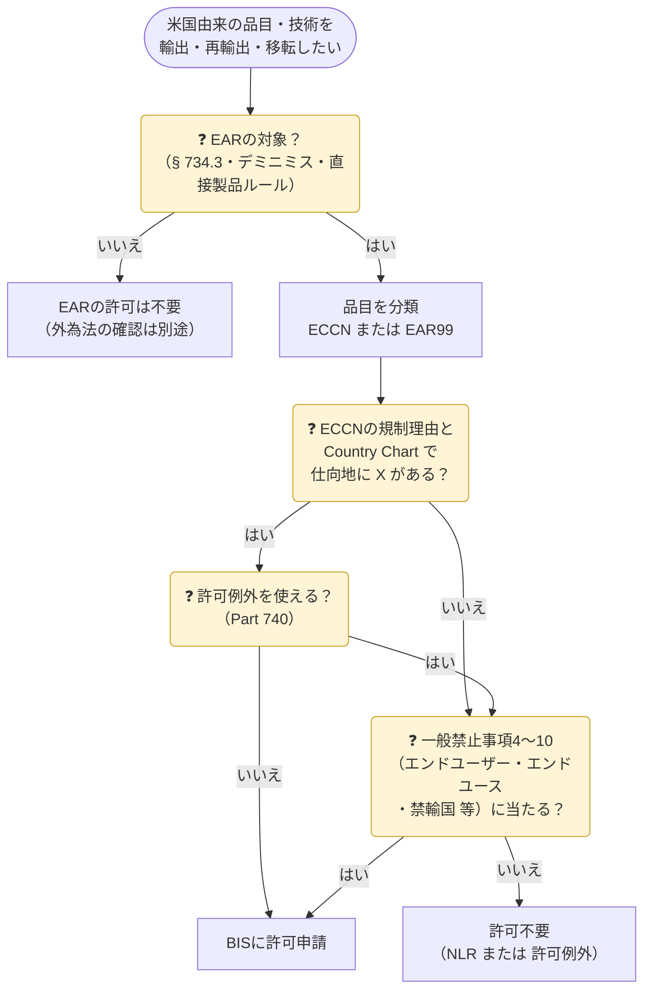

米国の**輸出管理規則**（Export Administration Regulations、**EAR**。15 CFR Parts 730–774）は、商務省産業安全保障局（**BIS**）が所管する米国の輸出管理です。根拠となる法律は**輸出管理改革法**（Export Control Reform Act of 2018、**ECRA**）です。

EARは**米国の外にある物にも適用されます**（域外適用）。日本から輸出する場合でも、米国製の部品・ソフトウェア・技術が入っていれば、外為法の許可とは別にEARの確認が必要になることがあります。

> 2026年10月19日時点の eCFR（15 CFR）をもとに整理しています。条文番号は「§ 740.3」のように示します。

## 外為法との違い

| 項目 | 日本（外為法） | 米国（EAR） |
|---|---|---|
| 所管 | 経済産業省 | 商務省 BIS |
| 規制リスト | 輸出令別表第1・外為令別表（1〜15項） | **CCL**（Commerce Control List、Part 774 補足1）。品目ごとに **ECCN** |
| リストに載らない品目 | 16項（キャッチオールの対象） | **EAR99**（エンドユース・エンドユーザー規制の対象） |
| 仕向地の区分 | グループA・一般国・懸念国 等 | **国グループ**（A〜E）と **Commerce Country Chart** |
| 許可が要らない場合 | 特例（輸出令第4条・貿易外省令第9条） | **許可例外**（License Exception、Part 740） |
| 外国からの再輸出 | 原則として規制しない | **再輸出・外国での移転も規制**（デミニミス・直接製品ルール） |
| 技術の提供 | みなし輸出（非居住者・特定類型への提供） | **みなし輸出**（米国内の外国人への開示）・**みなし再輸出**（米国外で第三国の国籍者に開示） |
| 取引相手のリスト | 外国ユーザーリスト（キャッチオールの判断材料） | **Entity List** 等（掲載者向けは**許可が必要**になる） |

{}
日本の許可を取っても、EARの許可は免除されません（逆も同じ）。米国由来の品目を扱う取引では、**両方の要否**を確認します。
{}

## どんな物がEARの対象になるか（§ 734.3）

「EARの対象（subject to the EAR）」かどうかが最初の分かれ目です。

| # | EARの対象になるもの | 日本企業での典型例 |
|---|---|---|
| 1 | **米国内にある**すべての品目（米国を通過中の物を含む） | 米国の倉庫から出荷する自社製品 |
| 2 | **米国原産**の品目（どこにあっても） | 米国から輸入した半導体・計測器・ソフトウェアを日本から再輸出 |
| 3 | 規制対象の米国原産品を**デミニミス水準を超えて組み込んだ**外国製品 | 米国製部品を組み込んだ日本製の装置 |
| 4 | 米国の技術・ソフトウェアの**直接製品**（直接製品ルールに当たるもの） | 米国製の設計ツール・製造装置で作った半導体 |

デミニミスと直接製品ルールは → **[デミニミス・直接製品ルール](de-minimis-fdp/)**

{}
- 国務省（ITAR）・エネルギー省など**他の省庁が専属的に管轄する品目**
- **公開済み**（published）の技術・ソフトウェア（暗号の一部を除く）
- **基礎研究**（fundamental research）から生じた技術・ソフトウェア
- 特許の内容など（§ 734.10）

日本の「公知の技術」「基礎科学分野の研究」に近い考え方ですが、条件は同じではありません。
{}

## 許可が要るかの判断手順

Part 732 の手順をまとめると、次の順番になります。

- **NLR**（No License Required）：許可も許可例外も要らない場合の表示です。
- 許可例外は**一般禁止事項1〜3・8**（品目・仕向地による規制）の許可を不要にするものです。Entity List や禁輸国などの規制（一般禁止事項4〜7・10など）は、原則として許可例外では外れません（→ [許可例外](license-exceptions/)）。

## ECCNの読み方

ECCN は5文字の分類番号です。例：**3A001**

| 位置 | 意味 | 例 |
|---|---|---|
| 1文字目（数字） | **カテゴリ**（0〜9） | 3 ＝ エレクトロニクス |
| 2文字目（英字） | **製品群**（A〜E） | A ＝ 装置・部品 |
| 3〜5文字目 | 規制理由（3文字目の番号帯）と通し番号 | 001 |

| カテゴリ | 内容 | 製品群 | 内容 |
|:-:|---|:-:|---|
| 0 | 原子力・その他 | A | システム・装置・部品 |
| 1 | 材料・化学・微生物・毒素 | B | 試験・検査・製造装置 |
| 2 | 材料加工 | C | 材料 |
| 3 | エレクトロニクス | D | ソフトウェア |
| 4 | コンピュータ | E | 技術 |
| 5 | 通信・情報セキュリティ | | |
| 6 | センサー・レーザー | | |
| 7 | 航法・航空電子 | | |
| 8 | 海洋 | | |
| 9 | 航空宇宙・推進 | | |

カテゴリ・製品群の並びは外為法の別表第1とほぼ同じです（どちらもワッセナー・アレンジメントの品目リストがもとになっています）。

| 3〜5文字目の番号帯 | 主な規制理由（§ 738.2） |
|---|---|
| 0xx | 国家安全保障（NS） |
| 1xx | ミサイル技術（MT） |
| 2xx | 核不拡散（NP） |
| 3xx | 化学・生物兵器（CB） |
| 5xx | 銃器・宇宙機など（旧USMLから移管） |
| 6xx | 「600シリーズ」：軍用品（ワッセナー軍用品リスト・旧USML） |
| 9xx（980〜989） | 犯罪防止（CC）・供給不足（SS） |
| 9xx（990〜999） | テロ支援防止（AT）・地域安定（RS）・国連制裁（UN） |

{}
EARの対象だが、CCLのどのECCNにも当たらない品目は **EAR99** です。多くの民生品がこれに当たります。EAR99 でも、**禁輸国向け・Entity List 掲載者向け・懸念用途**などでは許可が必要です。日本の「16項」に近い位置づけです。
{}

## Commerce Country Chart と日本

ECCN の「License Requirements」欄に書かれた**規制理由と列**（例：NS 1、AT 1）を、Country Chart（Part 738 補足1）の仕向地の行と突き合わせます。**X** があれば許可が必要です。

| 仕向地 | X がある列 |
|---|---|
| **日本** | CB 1、NS 1、MT 1、RS 1 |
| ドイツ | CB 1、NS 1、MT 1、RS 1 |
| インド | CB 1、NP 1、NS 1、MT 1、RS 1 |
| 中国 | CB 1〜3、NP 1〜2、NS 1〜2、MT 1、RS 1〜2、CC 1・3 |
| ベトナム | CB 1〜3、NP 1、NS 1〜2、MT 1、RS 1〜2、CC 1〜2 |

{}
ECCN の規制理由が「**NS 2・AT 1**」だけの品目なら、日本向けは NS 2 にも AT 1 にも X がないので、品目・仕向地による許可は不要（NLR）です。中国向けは NS 2 に X があるので、許可または許可例外が必要です。
{}

### 国グループ（Part 740 補足1）

許可例外の使える仕向地は、**国グループ**で指定されます。

| グループ | 意味 | 日本 |
|---|---|:-:|
| A:1 | ワッセナー・アレンジメント参加国 | ✓ |
| A:2 | ミサイル技術管理レジーム（MTCR） | ✓ |
| A:3 | オーストラリア・グループ | ✓ |
| A:4 | 原子力供給国グループ（NSG） | ✓ |
| A:5 | 最も緊密な同盟国（STA の主な対象） | ✓ |
| A:6 | A:5 に次ぐ国（STA の一部が使える） | ― |
| B | 多くの許可例外（LVS・GBS 等）が使える国 | ✓ |
| D:1〜D:5 | 国家安全保障・核・化学生物・ミサイルの懸念国、D:5 は米国の武器禁輸国 | ― |
| E:1・E:2 | テロ支援国・米国の単独禁輸国 | ― |

## 一般禁止事項（General Prohibitions、§ 736.2）

EARの許可が必要になるのは、次の**10の一般禁止事項**のどれかに当たる場合です。

| # | 内容 | 主な根拠 | 許可例外で外れる？ |
|:-:|---|---|:-:|
| 1 | CCL品目の**輸出・再輸出**（Country Chart に X） | Part 738・742 | ○ |
| 2 | 米国原産品を**デミニミス超で組み込んだ外国製品**の再輸出 | § 734.4 | ○ |
| 3 | **外国直接製品**（直接製品ルール）の再輸出等 | § 734.9 | ○ |
| 4 | **取引禁止命令**（Denied Persons）に反する行為 | Part 766 | × |
| 5 | 禁止された**エンドユース・エンドユーザー**向け（Entity List・軍事エンドユーザー・大量破壊兵器用途 等） | Part 744 | 原則 × |
| 6 | **禁輸国**向け（キューバ・イラン・北朝鮮・シリア、ロシア・ベラルーシ等） | Part 746 | Part 746 が認めるものだけ |
| 7 | **米国人**（U.S. person）による大量破壊兵器・軍事情報活動の支援 | § 744.6 | × |
| 8 | 特定国（ロシア・ベラルーシ・ウクライナなど旧ソ連諸国〔バルト三国を除く〕、カンボジア・キューバ・ラオス・モンゴル・北朝鮮・ベトナム）での**積み替え・通過** | § 736.2(b)(8) | ○ |
| 9 | 許可・許可例外の**条件違反** | ― | × |
| 10 | 違反が起きる・起きたと**知りながら**取引を続ける | ― | × |

## 罰則（§ 764.3、15 CFR 6.3）

| 種類 | 内容 |
|---|---|
| 刑事罰（故意の違反） | **100万ドル以下の罰金**、個人は**20年以下の拘禁**、又は併科 |
| 民事制裁金（違反1件ごと） | ECRA の上限額。2025年1月15日以降は **37万4,474ドル**（インフレ調整。ECRA は取引額の2倍の方が大きければその額を上限とする） |
| 輸出権限の剥奪 | **Denial Order**（取引禁止命令）。対象者は EAR対象品目のあらゆる取引から締め出される |
| その他 | 物品の没収、政府調達からの排除 など |

{}
EARは**米国外の企業・個人**にも適用されます。日本企業が米国原産品を無許可で懸念先に再輸出すると、BISの民事制裁金や **Entity List への掲載**の対象になり得ます。掲載されると、米国原産品や米国技術の直接製品を事実上調達できなくなります。
{}

{}
違反に気づいたら、BIS への**自主開示**（Voluntary Self-Disclosure）を検討します。制裁金の算定で大きく考慮されます。
{}

## このセクションのページ

| ページ | 内容 |
|---|---|
| [デミニミス・直接製品ルール](de-minimis-fdp/) | 日本製品がEARの対象になる2つの経路（米国部品の組込み・米国技術の直接製品） |
| [許可例外（License Exception）](license-exceptions/) | LVS・GBS・TMP・RPL・TSU・BAG・ENC・STA など、Part 740 の一覧と使えない場合 |
| [エンドユーザー・エンドユース規制](end-user-controls/) | Entity List・MEU List・Unverified List・Denied Persons、50%ルール、懸念用途、米国人の活動規制 |

## 公式情報

| 資料 | リンク |
|---|---|
| EAR 本文（eCFR） | [15 CFR Chapter VII, Subchapter C](https://www.ecfr.gov/current/title-15/subtitle-B/chapter-VII/subchapter-C) |
| BIS（商務省産業安全保障局） | [www.bis.gov](https://www.bis.gov/) |
| 取引相手のスクリーニング | [Consolidated Screening List](https://www.trade.gov/consolidated-screening-list)（Entity List・SDN 等を一括検索） |
| 日本語の解説 | [CISTEC](https://www.cistec.or.jp/)（米国輸出管理の資料・セミナー） |
