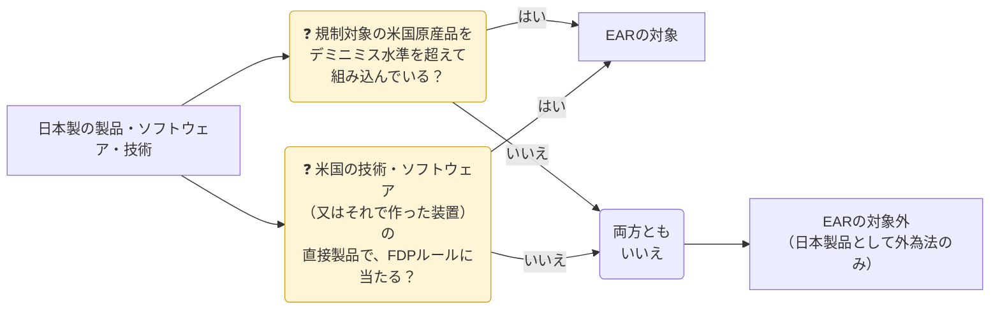
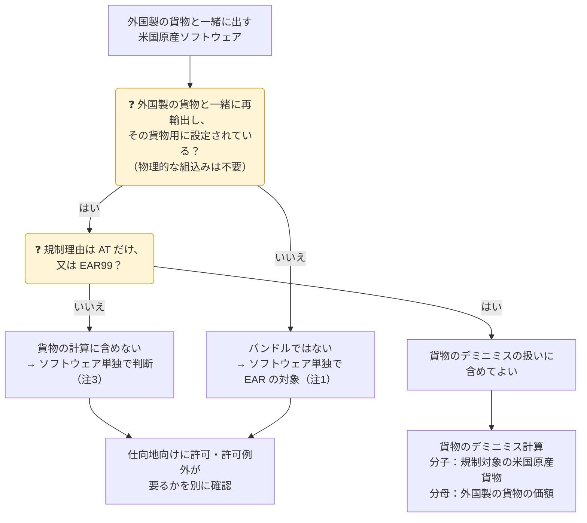

日本で作った製品でも、次の2つの経路でEARの対象になります（§ 734.3(a)(3)・(4)）。



## デミニミス・ルール（§ 734.4）

外国製品に組み込まれた**規制対象の米国原産品**（controlled U.S.-origin content）の割合が、一定の水準以下ならEARの対象外になります。

| 水準 | 仕向地 | 根拠 |
|---|---|---|
| **25%以下**なら対象外 | 国グループ **E:1・E:2 以外**（日本から一般の国へ） | § 734.4(d) |
| **10%以下**なら対象外 | 国グループ **E:1・E:2**（テロ支援国・米国の単独禁輸国） | § 734.4(c) |
| **割合に関係なく対象**（デミニミスなし） | 下の「デミニミスが使えない品目」 | § 734.4(a) |

### 計算のしかた（Part 734 補足2）

```text
米国原産の規制対象品の価額 ÷ 外国製品の価額 × 100 ≦ 25%（又は10%）
```

| 項目 | ポイント |
|---|---|
| 分子に入れる米国原産品 | 組み込んだ米国原産品ごとに ECCN を判定し、**そのまま仕向地へ輸出したら許可が要るもの**だけを数える。EAR99 や、仕向地へ NLR の品目は数えない。外国製の**貨物**の計算に入るのは米国原産の**貨物**で、NS などで規制される米国原産**ソフトウェア**は合算しない（→ [貨物とソフトウェアは別々に判断する](#貨物とソフトウェアは別々に判断する)） |
| 「組み込んだ」とは | 外国製品の機能に**不可欠**で、通常一緒に販売され、外国製品と一緒に再輸出されるもの |
| 分子の価額 | 製品を作る国の市場での**公正な市場価格**（通常は仕入価格） |
| 分母の価額 | 製品を売る市場での**公正な市場価格**（通常は販売価格）。関連会社間の安値取引は時価に引き直す |
| 設計・製造に使った米国技術 | 組み込んだことにならない（分子に入れない）。ただし直接製品ルールの対象になり得る |
| 外国技術に米国技術が混在する場合 | デミニミスを使う前に BIS への**1回限りの報告**が必要 |
| 記録 | 計算方法と根拠を**記録として保存**（§ 734.4(g)、Part 762） |

{}
仕向地向けに外国製品そのものが**許可不要**なら、計算は要りません（Part 734 補足2(a)）。逆に、仕向地が変わると「規制対象の米国原産品」の範囲が変わるので、**仕向地ごとに**計算します。
{}

### 貨物とソフトウェアは別々に判断する

デミニミスの計算は、外国製品の種類ごとに分かれています。

| 外国製品 | 分子に入れるもの | 分母 | 根拠 |
|---|---|---|---|
| **貨物** | 組み込んだ規制対象の米国原産**貨物** | 外国製の貨物の価額 | § 734.4(c)(1)・(d)(1) |
| **ソフトウェア** | 組み込んだ規制対象の米国原産**ソフトウェア** | 外国製のソフトウェアの価額 | § 734.4(c)(2)・(d)(2) |
| **技術** | 混在する、又は由来する規制対象の米国原産**技術** | 外国の技術の価額 | § 734.4(c)(3)・(d)(3)（事前に BIS へ1回限りの報告） |

外国製の**貨物**と一緒に扱われる米国原産ソフトウェアについては、§ 734.4(c)(1)・(d)(1) の注が次のように定めています。

| 米国原産ソフトウェア | 扱い |
|---|---|
| 外国製の貨物とバンドル（その貨物用に設定され、一緒に再輸出される。物理的な組込みは不要）され、**AT 理由だけ**で規制されるもの、又は **EAR99** のもの | 貨物のデミニミスの扱いに含めてよい |
| 外国製の貨物とバンドルされていても、**NS など AT 以外の理由**で規制されるもの | 貨物の計算に**含めない**。そのソフトウェアが EAR の対象かを**単独で**判断する |
| 外国製の貨物とは**別に**輸出・再輸出するもの | デミニミスの対象外。EAR の対象のまま |

#### 米国原産ソフトウェアの判定手順



| 手順 | 確認すること |
|---|---|
| ① バンドルか | 外国製の貨物と**同じ取引で一緒に**再輸出し、その貨物用に**設定**されているか。後日の別送や、汎用のソフトを同じ箱に入れただけのものはバンドルではない |
| ② 規制理由 | ECCN を判定し、規制理由が **AT だけ**か **EAR99** かを確認する。NS・MT・NP・CB・RS・EI など AT 以外の理由があれば、貨物の計算には含めない |
| ③ 貨物の計算 | 分子は、組み込んだ規制対象の米国原産**貨物**の価額（仕向地向けに許可が要るもの）。分母は外国製の貨物の価額。25%以下（E:1・E:2 向けは10%以下）なら、外国製の貨物は EAR の対象外 |
| ④ ソフトウェア単独の判断 | ①で別送、又は②で AT 以外の理由があったソフトウェアは、仕向地向けに許可・許可例外が要るかを確認する |
| ⑤ 記録 | 計算と判断の根拠を保存する（§ 734.4(g)、Part 762） |

{}
- **ファームウェアなど貨物に書き込まれたソフトウェア**：注3はバンドルしたソフトウェアについての規定です。組み込まれたファームウェアにも及ぶかは、条文の文言からは明確ではありません。米国原産の部品に最初から書き込まれているものは、通常、その部品の一部として部品の ECCN で扱います。NS 理由で規制されるソフトウェアを外国で書き込む場合などは、BIS のガイダンスで確認します。
- **AT 理由だけのソフトウェア**でも、E:1・E:2 向けでは許可が要ることがあります。10%ルールとあわせて確認します。
- <strong>暗号ソフトウェア（5D002）</strong>は NS・AT に加えて EI 理由でも規制されるため、バンドルしても貨物の計算には含められません。許可例外 ENC（§ 740.17）などを別に検討します。
- ソフトウェアを貨物と分けて判断する場合は、外国製の貨物の価額からソフトウェア分を分ける必要が出ることがあります。配分の根拠も記録します。
{}

{}
「NS 理由で規制される米国原産の部品とソフトウェアを組み込んだ日本製品の組込比率は、部品とソフトウェアの合計価格を日本製品の価格で割って求める」は**誤り**です。NS 理由で規制されるソフトウェアは貨物の計算に合算できず、ソフトウェアとして単独で EAR の対象かを判断します。分子に入れるのは、規制対象の米国原産<strong>部品（貨物）</strong>の価額です。
{}

> eCFR の § 734.4（2026年10月26日時点）で確認しています。

### デミニミスが使えない品目（§ 734.4(a)）

| 品目 | 内容 |
|---|---|
| 暗号技術 | **5E002** の米国原産暗号技術を組み込んだ外国の暗号技術 |
| 高性能コンピュータ | 一定の性能を超え、3A001 の米国原産半導体を含むコンピュータ（Computer Tier 3 向け） |
| 先端半導体製造装置 | **3B993.f.1** の装置で先端ノードIC の開発・製造に使うもの。ただし、**輸出元の国がその装置を自国の規制リストに入れていれば**この扱いはない（日本は2023年7月23日に追加済み） |
| 一部の 3B 装置 | 米国原産の IC を含む 3B001・3B002 等の装置を、マカオ・D:5 向けに（SME FDP 関連）など |
| ジェットエンジン技術 | 9E003 の一部の米国技術 |
| 軍用品 | **9x515・600シリーズ**の米国原産品を組み込んだ製品（D:5 向け。.y 品目は E:1・E:2・中国・ロシア・ベラルーシ向け） |

{}
- デミニミス以下でも、**米国原産品そのもの**を単体で再輸出すればEARの対象です。
- 米国人（U.S. person）による大量破壊兵器関連の**支援の禁止**（§ 744.6）は、デミニミスにかかわらず適用されます。
- 米国財務省（OFAC）の制裁は別の規制です。
{}

## 外国直接製品ルール（FDPルール、§ 734.9）

米国の**技術・ソフトウェア**から直接作られた外国製品（直接製品）や、米国技術の直接製品である**工場・主要装置**で作られた外国製品は、ルールごとの「製品の範囲」と「仕向地・需要者の範囲」の**両方**に当たるとEARの対象になります。米国原産品を1つも組み込んでいなくても対象になるのが特徴です。

| ルール | 条項 | 製品の範囲（要約） | 仕向地・需要者の範囲（要約） |
|---|---|---|---|
| 国家安全保障（NS） | (b) | 書面保証が必要な米国の NS 技術・ソフトの直接製品で、NS 規制の品目 | D:1・E:1・E:2 |
| 9x515 | (c) | 9x515 の技術・ソフトの直接製品 | D:5・E:1・E:2 |
| 600シリーズ | (d) | 600シリーズの技術・ソフトの直接製品 | D:1・D:3・D:4・D:5・E:1・E:2 |
| **Entity List**（脚注1・4・5） | (e) | 3D・3E・4D・4E・5D・5E 等の米国技術・ソフト（又はそれで作った装置）の直接製品 | Entity List で**脚注1・4・5**の付いた者が関与する取引（**Huawei** は脚注1） |
| ロシア・ベラルーシ・クリミア | (f) | CCL の技術・ソフトの直接製品 | ロシア・ベラルーシ・クリミア向け、又はそこで使う部品・装置の製造等に使う |
| ロシア・ベラルーシ軍事エンドユーザー | (g) | EAR対象の技術・ソフトの直接製品 | Entity List で脚注3の付いた者 |
| **先端コンピューティング** | (h) | 3A090・4A090・.z 品目等（米国技術・ソフト、又はそれで作った装置による製品） | 仕向地を問わない（許可の要否は § 742.6 等で判断） |
| スーパーコンピュータ | (i) | 3〜5類の技術・ソフト等の直接製品 | 中国・マカオにあるスーパーコンピュータの開発・製造・保守等 |
| イラン | (j) | 米国の技術・ソフトの直接製品 | イラン向け、又はイラン政府が取引の当事者 |
| <strong>半導体製造装置（SME）</strong> | (k) | 3B001・3B002 の一部の装置で、米国技術・ソフトの直接製品 | マカオ・D:5 |
| AIモデルの重み | (l) | 先端計算用IC等で作られた AI モデルの重み（4E091） | 仕向地を問わない |

{}
- **半導体・電子部品メーカー**：米国の EDA ツールや製造装置を使って作ったチップを、<strong>Entity List 掲載者（脚注1等）</strong>やその関係先に販売すると、EARの許可が必要になります。購入者が直接の掲載者でなくても、掲載者が使う部品の製造に使われると知っていれば対象です。
- **装置メーカー**：米国技術の直接製品である装置を中国向けに出荷する場合、SME FDP・先端コンピューティング FDP に当たらないか確認します。
- 「日本製だから EAR は関係ない」とは言えません。**設計・製造に使った米国の技術・ソフトウェア**まで遡って確認します。
{}

{}
「直接製品」（direct product）は、技術・ソフトウェアを**直接使って**作られた製品です（§ 772.1）。間に別の工程や他の技術が入る程度では外れないことが多いため、迷ったら BIS の Advisory Opinion や FAQ、専門家に確認します。
{}

## みなし再輸出（§ 734.14(b)・§ 734.20）

EARの対象の**技術・ソースコード**を、**米国外**で第三国の国籍の人に開示することは、その人の国籍国（最も新しい国籍又は永住権の国）への**みなし再輸出**です。

| 例 | 判断 |
|---|---|
| 日本の事業所で、米国から受け取った規制技術を**中国籍の社員**に見せる | 中国への再輸出とみなされる。中国向けに許可が必要な技術なら許可が必要 |
| 同じ技術を**A:5 の国籍者**（例：ドイツ籍）に見せる | 一定の条件（技術を正当に受け取った事業者による開示 等）のもとで、みなし再輸出に当たらない（§ 734.20(b)） |
| 開示先の国籍国へ、米国から直接<strong>許可不要（又は許可例外）</strong>で出せる技術 | みなし再輸出に当たらない（§ 734.20(a)） |

日本のみなし輸出（[04 役務取引](../../04-technology-transfer/#みなし輸出)）は「居住者か非居住者か」で判断しますが、EARは**国籍**で判断します。社内の技術アクセス管理では、両方の基準を満たす必要があります。
