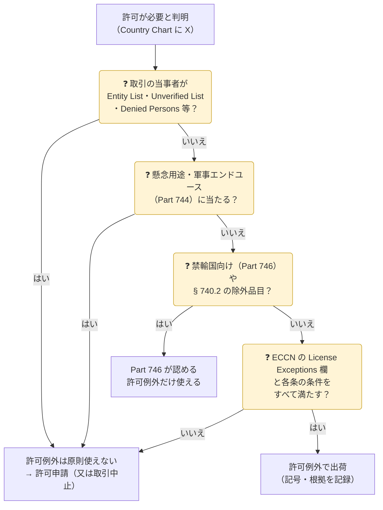

**許可例外**（License Exception）は、本来は許可が必要な輸出・再輸出を、**条件を満たせば許可なしで行える**ようにする EAR の仕組みです（15 CFR Part 740）。日本の「特例」（[05 特例・例外](../../05-exceptions/)）に当たりますが、種類がずっと多く、それぞれ3文字の記号で呼ばれます。

> 2026年10月19日時点の eCFR（15 CFR Part 740）をもとに整理しています。

{}
- 許可例外が外すのは、主に**品目と仕向地による許可**（一般禁止事項1・2・3・8）と、Part 746 が認める範囲の禁輸国向けの許可です（§ 740.1(a)）。
- 許可例外を使うと、**条件をすべて満たしていると証明した**ことになります（§ 740.1(b)）。根拠と判断の**記録を保存**します（Part 762）。
- 米国から輸出する場合は、輸出申告（EEI）に許可例外の記号と ECCN を記載します（§ 740.1(d)）。
{}

## 使う前のチェック（§ 740.2）

### 許可例外が使えない主な場合（§ 740.2(a)）

| 場合 | 内容 |
|---|---|
| 一般禁止事項に当たる | Entity List・軍事エンドユーザー・懸念用途など Part 744 の許可要件、Denied Persons（一般禁止事項4〜10）は、許可例外では外れない |
| **Unverified List** | 取引当事者が Unverified List（UVL）に載っている（§ 740.2(a)(17)） |
| 禁輸国 | キューバ・イラン・北朝鮮・シリア・クリミア等、ロシア・ベラルーシ向けは、Part 746 に定めのあるものだけ（§ 740.2(a)(6)） |
| ミサイル技術（MT） | MT 規制品目は TMP・RPL・GOV・TSU・AVS・APR・STA の一部だけ |
| 盗聴用品 | 5A001.f.1・5A980 等（政府用を除く） |
| 600シリーズ・9x515 | D:5・香港向けは GOV 等に限られる。それ以外も使える許可例外が限定 |
| 先端半導体・製造装置 | 3B001 の一部・3A090・4A090 等をマカオ・D:5 向けなど（GOV・TMP の一部・NAC/ACA・HBM 等に限る） |
| 香港向け | NS・MT・NP 1・CB 規制品目は、香港政府の輸入許可（又は不要の書面）が必要 |

## 許可例外の一覧

### よく使うもの

| 記号 | 条 | 内容 | 主な条件 |
|:-:|---|---|---|
| **LVS** | § 740.3 | 少額貨物 | 国グループ **B** 向け。同じ注文・同じ ECCN の純価額が、ECCN ごとの「LVS - $（上限額）」以下。同じ荷受人への年間合計は上限額の**12倍**まで。**注文の分割は禁止** |
| **GBS** | § 740.4 | 国グループB向けの貨物 | 国グループ B 向け（スーダン・ウクライナを除く）。Country Chart で許可が必要な理由が **NS だけ**で、ECCN に「GBS—Yes」とあるもの |
| **TSR** | § 740.6 | 制限付きの技術・ソフトウェア | NS だけの技術・ソフトを国グループ B 向けに。輸入者から**再輸出しない旨の書面保証**（D:1・E:1・E:2 向けの再輸出・直接製品の輸出をしない）を取る |
| **TMP** | § 740.9 | 一時的な輸出 | 出張者の**業務用具**（E:1 以外。実効的な管理下に置く）、展示・デモ、検査・修理、交換部品キット、ベータテスト用ソフト 等。**1年以内に返送**（受注済みの物・売却予定の物は不可） |
| **RPL** | § 740.10 | 修理・交換部品 | 正規に輸出された装置の**1対1の交換部品**（取り外した部品は廃棄又は返送）。予備品として保管する目的は不可。保証期間内の修理・交換品の返送も |
| **GOV** | § 740.11 | 政府・国際機関 | 米国政府機関・職員の公用、協力国政府機関、IAEA・Euratom の保障措置、化学兵器禁止条約の査察、国際宇宙ステーション |
| **TSU** | § 740.13 | 制限のない技術・ソフトウェア | 据付・操作・保守の**最小限の使用技術**、**販売技術**（見積・入札用。設計・製造技術は含まない）、**バグ修正**、**一般市販ソフト**（E:1 以外。EI 規制の暗号ソフトは除く）、米国の大学による常勤職員への開示 |
| **BAG** | § 740.14 | 手荷物 | 米国を出国する個人の私物・家財・車両・**業務用具**（本人所有・本人用・売却しない）。技術は米国人だけ。銃器は米国市民・永住者で3丁まで |
| **APR** | § 740.16 | 追加の許容的な再輸出 | 下の「日本からの再輸出で使えるもの」を参照 |
| **ENC** | § 740.17 | 暗号品目 | 5A002・5D002・5E002 等。E:1・E:2 向けは不可。品目により事前の分類申請・自己分類報告・半期報告が必要 |
| **STA** | § 740.20 | 戦略的貿易認可 | **A:5 向け**は NS・CB・NP・RS・CC・SI のみの品目（MT は一部）。**A:6 向け**は NS だけで、STA 欄の除外がない品目。荷受人から**事前の荷受人声明**（Prior Consignee Statement）を取り、ECCN を通知する |

### 特定の分野・仕向地向け

| 記号 | 条 | 内容 |
|:-:|---|---|
| SPP | § 740.5 | シリア向けの EAR99 品目（Part 744 の許可要件がある取引は除く） |
| APP | § 740.7 | コンピュータ（4A003 等）。仕向地の Computer Tier ごとに対象を規定（日本は Tier 1） |
| NAC・ACA | § 740.8 | 先端計算用 IC 等（3A090・4A090・.z 品目）。マカオ・D:5 向けは事前通知（NAC） |
| GFT | § 740.12 | 贈答品・人道支援物資 |
| AVS | § 740.15 | 航空機・船舶・宇宙機と、その搭載用の装置・予備品 |
| AGR | § 740.18 | キューバ向けの農産品 |
| CCD | § 740.19 | 消費者向け通信機器（PC・携帯電話等）をベラルーシ・キューバ・ロシア・シリア向けに |
| SCP | § 740.21 | キューバ国民の支援 |
| ACE | § 740.22 | サイバーセキュリティ品目（4A005・4D004・5A001.j 等）。E:1・E:2 の国籍者・政府エンドユーザー向け等は除く |
| MED | § 740.23 | ロシア・ベラルーシ等向けの EAR99 の医療機器と交換部品（禁止された者・製造施設向けは不可） |
| IEC | § 740.24 | 他国が同等の規制を実施した品目（量子・半導体等）を、指定された国の間で |
| HBM | § 740.25 | 広帯域メモリ（3A090.c） |
| RFF | § 740.26 | Entity List の「制限付き製造施設」向け（3B 等の装置を除く） |
| AIA・ACM・LPP | § 740.27〜29 | 先端計算用 IC・AI モデルの重みの許可例外 |

## 日本からの再輸出で使えるもの

日本は国グループ **A:1〜A:5** と **B** に入っています（A:6 には入っていない）。日本の企業が米国原産品を再輸出するときに検討する主な許可例外は次のとおりです。

| 場面 | 検討する許可例外 | ポイント |
|---|---|---|
| 米国原産品を<strong>ワッセナー参加国（A:1）</strong>の間で再輸出する | **APR**（§ 740.16(b)） | A:1 の国の中で使用・消費されるもの。NP・MT 規制品、3A001.b.2・b.3・.z、6A002、0A919、0x5zz 等は対象外 |
| 日本の輸出許可を得て、NS 規制品を B・D:1 の国へ再輸出する | **APR**（§ 740.16(a)） | **日本政府の輸出許可の条件どおり**に行う。NP・CB・MT・SI・CC 規制品等は対象外。北朝鮮は不可 |
| 米国から直接**許可例外で出せる**仕向地へ再輸出する | 各許可例外（§ 740.3(e) 等） | 多くの許可例外は「米国からその国へ直接出せるなら再輸出も可」という構造 |
| 外国製品と一緒に米国原産の**予備部品**を送る | **APR**（§ 740.16(h)） | 外国製品の価額の**10%以下**まで |
| 修理・交換部品を送る | **RPL** | 1対1交換。予備在庫は不可 |
| 展示会・デモ・出張で一時的に持ち出す | **TMP** | 1年以内に返送 |
| 見積・入札のための技術資料を出す | **TSU**（販売技術） | 設計・製造の詳細は含めない |
| A:5 の国の企業へ NS 規制品を出す | **STA** | 事前の荷受人声明を取り、ECCN を通知 |

{}
- 少額だからと **LVS** を使ったが、同じ荷受人への**年間合計が上限額の12倍**を超えていた。
- 展示会用に **TMP** で持ち出した装置を、現地で**そのまま販売**した（TMP は売却予定の物には使えない）。
- **APR** で再輸出したが、相手が **Entity List の50%子会社**だった（許可例外では外れない）。
{}

{}
- 使った許可例外の**記号と条項**（例：TMP § 740.9(a)(1)）
- ECCN と、その ECCN の License Exceptions 欄に該当することの確認
- 当事者の**スクリーニング結果**（Entity List・UVL 等に当たらないこと）
- 必要な書面（TSR の書面保証、STA の事前荷受人声明 等）
{}
