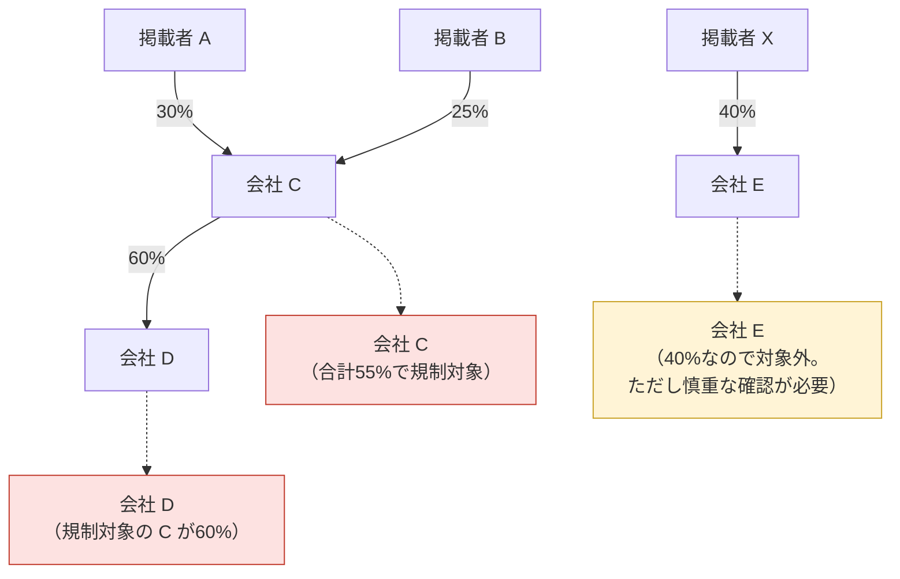
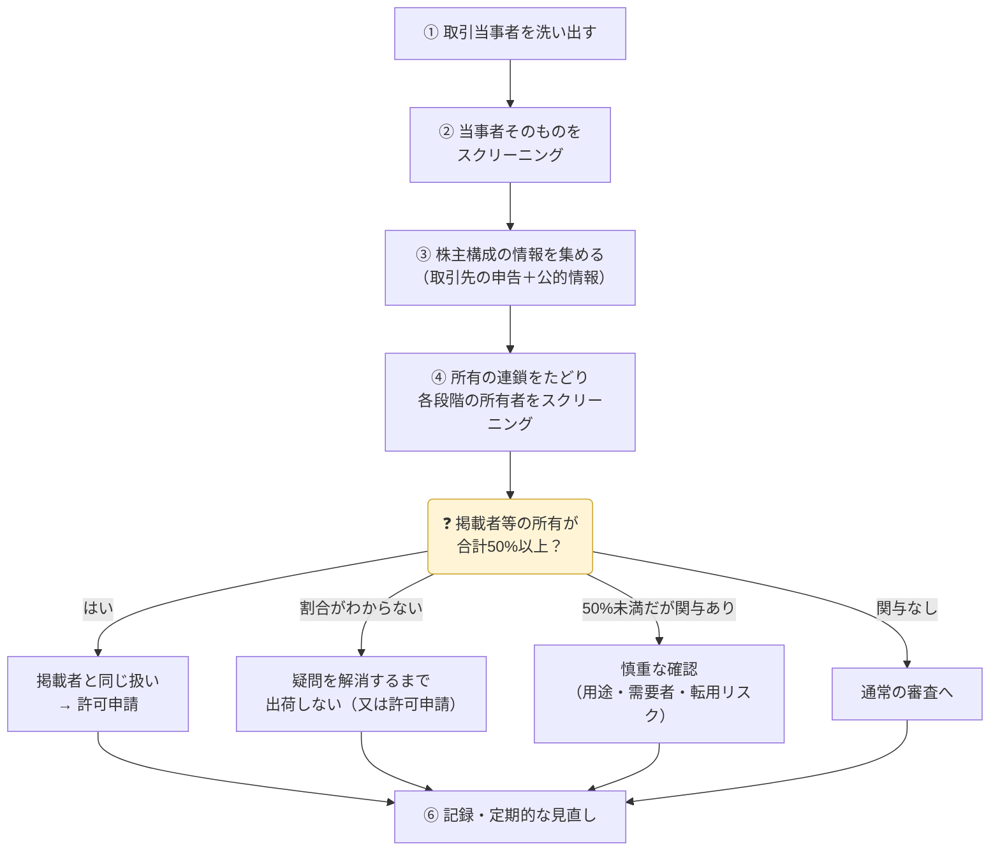

Entity List・MEU List の掲載者が**50%以上**を所有する会社は、名前がリストに載っていなくても、掲載者と同じ規制を受けます（→ [エンドユーザー規制](../end-user-controls/#entity-list-の50ルールaffiliates-ルール)）。このページでは、取引先の株主構成を**最終的な所有者まで**確認する手順をまとめます。

> 根拠は 15 CFR Part 744 補足8（50%ルールの適用ガイドライン）と Part 732 補足3（レッドフラッグ29）です。2026年10月19日時点の eCFR で確認しました。50%ルールは**2026年11月9日まで停止中**で、延長がなければ11月10日から適用されます。

## 判定のルール（Part 744 補足8(b)）

| 項目 | 内容 |
|---|---|
| 対象になる会社 | Entity List・MEU List の掲載者、一部の SDN（§ 744.8(a)(1) のプログラム）、又は所有関係によって既に規制対象になっている会社が、**直接・間接に、単独又は合計で50%以上**を所有する外国の会社 |
| 扱い | その会社自体が、所有者と同じリストに**載っているものとみなされる** |
| 所有者が複数のリストにまたがる | 所有者に適用される規制のうち、**最も厳しいもの**（許可要件・許可例外・審査方針）が適用される |
| 割合がわからない | 掲載者が所有に関わっているなら、疑問を解消するか、BIS の**許可を取ってから**取引する |

{}
取引当事者の所有者に Entity List・MEU List の掲載者（又は所有関係で規制対象になっている会社）がいると**知っている**場合、輸出者には**所有割合を確認する積極的な義務**があります。確認できなければ、許可例外が使える場合を除き、BIS の許可が必要です。
{}

### 割合の数え方

| 例 | 判定 |
|---|---|
| 掲載者Aが30%、掲載者Bが25%を所有 | **合算**して55% → 規制対象 |
| 上の会社C（規制対象）が、会社Dの60%を所有 | **間接所有**。規制対象の会社が50%以上を持つので、D も規制対象 |
| 掲載者Xが40%を所有 | 50%未満なので対象外。ただし補足8(c) により**慎重な確認**が必要 |

{}
財務省 OFAC の50%ルールにそろえた仕組みとされています。各段階で「50%以上を所有されて規制対象になった会社」を所有者として数え直していくと、判定しやすくなります。細かいケースは BIS の FAQ・ガイダンスで確認してください（→ [OFAC の50%ルールとの違い](#ofac-の50ルールとの違い)）。
{}

## OFAC の50%ルールとの違い

米国財務省の外国資産管理室（**OFAC**）にも、同じ「50%ルール」があります。どちらも「リスト掲載者が**合計50%以上**を所有する会社は、掲載者と同じ扱い」という骨組みは同じです。違うのは、**何が禁止されるか**と**誰が守るか**です。

> OFAC 側は、OFAC の [FAQ 398〜402](https://ofac.treasury.gov/faqs/topic/1521)（2014年8月13日の改訂ガイダンスにもとづくもの。398 は2020年8月11日公表）で確認しました。

| 項目 | OFAC（財務省）の50%ルール | BIS（商務省）の Affiliates ルール |
|---|---|---|
| 根拠 | OFAC の改訂ガイダンス（2014年8月13日）と FAQ 398〜402 | EAR § 744.11(a)(1)、Part 744 補足8（2025年9月の暫定最終規則） |
| 現在の状況 | 施行中 | <strong>2026年11月9日まで停止中</strong>。延長がなければ11月10日から適用 |
| 所有者になるリスト | SDN などの**資産凍結対象者**（blocked persons） | **Entity List・MEU List**、§ 744.8(a)(1) のプログラムの **SDN** |
| 対象になる会社 | 会社の所在地を問わない | **外国の会社**（foreign entity） |
| 合算 | 合算する。**制裁プログラムが違っても**合算（FAQ 399） | 合算する。所有者が複数のリストにまたがる場合は、**最も厳しい規制**を適用 |
| 間接所有 | 掲載者が**50%以上を所有する会社を経由**した所有を数える。経由する会社の所有が50%未満なら、その先には及ばない（FAQ 401） | 同じ考え方（掲載者、又は所有関係で規制対象になった会社による所有を数える） |
| 効果 | その会社の**資産が凍結**され、**取引全般**（物品・サービス・金融・契約など）が原則として禁止 | その会社が当事者になる取引で、**EARの対象品目**の輸出等に**許可が必要**（掲載の範囲・審査方針も引き継ぐ） |
| 対象になる物・取引 | 品目を問わない | <strong>EARの対象品目だけ</strong>（米国原産品、デミニミス超の外国製品、直接製品など） |
| 主に守る義務がある者 | **米国人**（米国法人の海外支店、米国籍の個人などを含む） | **誰でも**（日本企業もEARの対象品目を扱えば対象） |
| 割合がわからないとき | 適切な**デューデリジェンス**を求める（FAQ 401） | **レッドフラッグ29**。割合を確認する**積極的な義務**があり、確認できなければ許可が必要 |
| 支配（control）だけの場合 | 50%ルールは**所有だけ**が対象で、支配は含まない。ただし、掲載者である個人が支配する会社と取引するとき、その個人が署名する契約などは禁止（FAQ 398・400） | 50%未満なら対象外。ただし補足8(c) で慎重な確認を求める |
| 所有が50%未満に下がった | 米国の管轄外で売却されれば、自動的な凍結対象ではなくなる。ただし**既に凍結された財産は凍結のまま**。見せかけの売却でないかの確認を求める（FAQ 402） | 規定なし（その時点の所有割合で判定） |
| 住所だけの掲載 | ― | 掲載された住所で活動する会社が所有していても、**対象にならない** |

### 日本企業にとっての違い

| # | ポイント |
|:-:|---|
| 1 | **BIS のルールは、日本企業に直接かかります。** 米国原産品や米国技術の直接製品を掲載者の50%子会社に出すと、日本企業でも EAR 違反になり得ます |
| 2 | **OFAC のルールは、主に米国人の義務です。** ただし、米ドル決済で米国の銀行が関わる場合、米国籍の社員・米国子会社が取引に関わる場合、二次制裁がある制裁プログラム（ロシア・イランの一部 等）では、日本企業にも影響します |
| 3 | **SDN が所有する会社は、両方の対象になり得ます。** § 744.8(a)(1) のプログラムで指定された SDN が所有者なら、OFAC の資産凍結と BIS の許可要件が重なります |
| 4 | **確認作業は共通化できます。** 株主の連鎖をたどる手順は同じなので、1回の株主確認で、**SDN と Entity List・MEU List の両方**を照合します |

## 確認の手順

| # | ステップ | やること |
|:-:|---|---|
| ① | 取引当事者を洗い出す | 購入者・中間荷受人・最終荷受人・エンドユーザー（§ 748.5 の当事者）。直接の取引先だけでなく、**商社の先の最終需要者**も含める |
| ② | 当事者そのものをスクリーニング | [Consolidated Screening List](https://www.trade.gov/consolidated-screening-list) で検索。社名に加え、**別名・旧社名・住所**でも確認 |
| ③ | 株主構成の情報を集める | 取引先に**株主構成の申告書**（最終の親会社・支配株主まで、比率付き）を求め、下の公的情報で裏付ける |
| ④ | 所有の連鎖をたどる | 株主ごとに、さらにその株主へと**最上位まで**たどる。各段階の所有者も②と同じくスクリーニングし、上の「割合の数え方」で判定 |
| ⑤ | 判定に応じて対応 | 下の表のとおり |
| ⑥ | 記録・定期的な見直し | 下の「記録と見直し」のとおり |

### 判定ごとの対応

| 結果 | 対応 |
|---|---|
| 掲載者等の所有が**50%以上** | 掲載者と同じ扱い。リストの範囲で**許可が必要**（許可例外は原則使えない） |
| 50%未満だが、掲載者が**大きな持分**を持つ／取引先が掲載者の**親会社** | 補足8(c) により慎重に確認。品目が掲載者に流れないこと（用途・需要者）を確認する。**将来リストに載る**可能性もある |
| **割合がわからない**（掲載者が関わっている） | 疑問を解消するまで出荷しない。解消できなければ許可を取る |
| 掲載者の関与なし | 通常の取引審査へ |

## 株主構成を調べられる公的な情報源

無料で調べられる国もありますが、わかるのはふつう**直接の株主まで**です。多層構造は、1段ずつ国をまたいでたどる必要があります。

> 2026年10月時点の各サイトの案内などによります。公開範囲・料金は変わるので、使う前に各サイトで確認してください。

| 国・地域 | 情報源 | わかること | 費用・注意点 |
|---|---|---|---|
| **中国** | [国家企业信用信息公示系统](https://www.gsxt.gov.cn/) | 株主（出資者）と出資額、法定代表者、変更履歴 | 無料。中国語のみ。1段ずつ確認する |
| 中国 | 企查查・天眼查・爱企查（民間） | 「股权穿透」図で多層の所有関係を表示 | 無料枠は限定的。結果は公的記録で裏付ける |
| 中国（上場） | [巨潮资讯网](http://www.cninfo.com.cn/) | 年報の大株主・実際の支配者 | 無料。上場企業のみ |
| **英国** | [Companies House](https://find-and-update.company-information.service.gov.uk/) | 役員、提出書類、**PSC**（株式・議決権の25%超を持つ者など、重要な支配力を持つ者） | 無料。保有割合は25%超〜50%などの**幅**で表示 |
| **米国**（上場） | [SEC EDGAR](https://www.sec.gov/edgar/search/) | 年次報告（10-K）、5%超の大量保有報告（13D/13G） | 無料。非上場企業の株主は原則として非公開 |
| **香港** | [Companies Registry](https://www.cr.gov.hk/) | 年次報告書（NAR1）に株主の情報 | オンライン検索は**有料**（書類ごとの手数料） |
| **シンガポール** | [ACRA Bizfile](https://www.bizfile.gov.sg/) | 有料の Business Profile に役員・株主・資本金 | 名称検索は無料、株主は**有料**。実質的支配者の登録簿は非公開 |
| **台湾** | 経済部 商工登記公示資料查詢 | 会社の基本情報、役員とその持株数 | 無料。株主全体の一覧は出ないことが多い |
| **ロシア** | [ЕГРЮЛ](https://egrul.nalog.ru/) | 有限会社（ООО）の出資者 | 無料。株式会社（АО）の株主は原則として載らない（株主名簿管理人が管理）。日本からつながりにくいことがある |
| **EU 各国** | 各国の実質的支配者登録簿 | 実質的支配者 | 2022年11月の EU 司法裁判所の判決以降、一般公開を止めた国が多い |
| **UAE** | ― | 一般公開の株主登記はほぼない | 取引先の申告に頼る |
| **日本**（上場） | [EDINET](https://disclosure2.edinet-fsa.go.jp/) | 有価証券報告書の「大株主の状況」 | 無料。非上場企業の株主は登記にも載らない |
| **日本**（非上場） | 実質的支配者リスト（法務局） | 法人の実質的支配者 | 一般公開はされない。**取引先に写しの提出を求める** |

### 国をまたいで調べるときのツール

| ツール | 内容 |
|---|---|
| [OpenCorporates](https://opencorporates.com/) | 多くの国の会社登記を横断して検索できる。株主情報の有無は国によって違う |
| [Open Ownership Register](https://register.openownership.org/) | 実質的支配者のデータを集約したもの。対象の国は限られる |
| [ICIJ Offshore Leaks Database](https://offshoreleaks.icij.org/) | オフショア法人の関係（漏えい情報が元） |
| [Consolidated Screening List](https://www.trade.gov/consolidated-screening-list) | 各段階の所有者がリスト掲載者かどうかの照合用（株主構成そのものはわからない） |

{}
- **「50%子会社の一覧」は公式には公表されていません。** BIS も OFAC も掲載者の子会社リストを出していないため、確認は輸出者の責任です。
- **多層構造は手作業になります。** 親会社、その親会社と、国をまたいで1段ずつ調べます。
- **見えない所有関係があります。** 名義株、信託、中国の VIE 構造（契約による支配）は登記に出ません。
- **情報が古いことがあります。** 登記に反映されるまで時間差があります。
{}

{}
取引先が多い場合や、中国・ロシアとその周辺国との取引が多い場合は、多層の所有関係やリスト掲載者との関係を表示できる**有料の企業データベース**（Orbis、Sayari、Kharon、Dow Jones など）を検討します。件数によっては、手作業より確実で、費用も抑えられます。
{}

## 記録と見直し

| 項目 | 内容 |
|---|---|
| 記録すること | 取引先の申告書、調べた**情報源**とその**取得日**、所有の連鎖の図、判定結果、判定者（Part 762） |
| 見直すタイミング | **新規取引の前**、**年1回**などの定期点検、**リストの改正時**（Entity List への追加は頻繁）、取引先の**組織再編・増資**を知ったとき |
| 契約での手当て | 株主構成が変わったときの**通知義務**、リスト掲載者に所有されていないことの**表明保証**、違反時の**解除条項** |

{}
- 取引先の申告を**そのまま信じた**が、公的な登記では別の株主が載っていた → 申告と公的情報の食い違い自体がレッドフラッグです。
- 直接の株主だけ確認し、**親会社の親会社**が掲載者だった → 最上位まで確認します。
- 初回の取引で確認したきり、**数年後に親会社がリストに追加**されていた → 定期的に見直します。
{}
